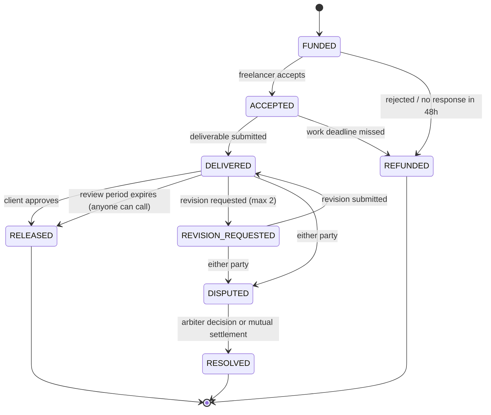

# NEAR Escrow

**Escrow for freelancers, enforced by a smart contract.** A client locks the money before work starts. The freelancer gets paid when the work is approved. If they disagree, a human arbiter both sides agreed on decides — and nobody in the middle ever holds the funds.

> NEAR Hackathon 2026 · track: `realworld` (with `agents` if the AI dispute summary ships)

---

## The problem

A freelancer in Bandung takes a contract from a client in Berlin. Both sides are exposed:

| Who | What they risk |
|---|---|
| Client | Paying upfront and receiving nothing, or something that does not match the brief. |
| Freelancer | Doing the work and not getting paid — or getting paid through a platform that takes 3–7% and a bad exchange rate. |
| Both | When it goes wrong, there is no shared rulebook and no neutral party. |

Large freelance platforms solve this by taking a big cut and holding the money themselves. This project solves it by putting the rules in code and the money in a contract that neither party controls.

## How it works

1. **Client creates a project** — freelancer, arbiter, brief, deadline, and the escrow amount is deposited in the same transaction.
2. **Freelancer accepts** (within 48h) or rejects, which refunds the client.
3. **Freelancer submits** a deliverable link before the deadline.
4. **Client approves** (funds released), **requests a revision** (max 2, each adds 3 days), or **opens a dispute** within the 72-hour review window.
5. **Silence is not a trap** — if the client does nothing for 72 hours, anyone can trigger release to the freelancer.
6. **Dispute** — funds freeze. Both sides submit evidence. The arbiter sets the split (0–100%). Both sides can also settle mutually at any percentage they both accept.
7. **Withdraw** — allocated funds are pulled by each recipient to their own wallet.



### Why "withdraw" is a separate step

Settlement writes an **allocation**, it does not push money. Each recipient then withdraws their own balance. This is deliberate: a transfer that fails (insufficient gas, a locked account) can never roll back or corrupt a settlement decision that was already agreed on-chain. The recipient simply retries.

## What makes this different

1. **No third party holds the money.** Not us, not a platform — a contract. There is no admin key that can move user funds.
2. **The dispute process is public.** Evidence, arbiter decision, and the exact split are on-chain and readable by anyone, forever.
3. **Reputation cannot be faked.** A freelancer's completed projects, total value, and dispute history are derived from contract state, not from a profile the user edits.

## Tech stack

| Layer | Choice |
|---|---|
| Smart contract | Rust · `near-sdk` 5.30 · NEAR Testnet |
| Frontend | React 19 · TypeScript · Vite · `near-wallet-selector` |
| AI dispute summary (optional) | Serverless function calling an LLM — advisory only, never touches funds or the contract |

## Repository layout

```
contract/     Rust smart contract (near-sdk)
app/          React frontend + the optional AI endpoint
docs/         Specification set (read these in order, see below)
```

## Documentation

The project is spec-first: the contract is a direct implementation of these documents, and every design decision with a trade-off is recorded in a Decisions Record inside them.

| # | Document | What it answers |
|---|---|---|
| 00 | [PRD](docs/PRD%20NEAR%20Escrow%20untuk%20Freelancer.md) | Problem, target users, scope, demo script |
| 01 | [FSD](docs/FUNCTIONAL%20SPECIFICATION%20DOCUMENT%20(FSD).md) | Business rules, roles, error codes, acceptance criteria |
| 02 | [STS](docs/State%20Transition%20Specification%20(STS).md) | Every status and every legal transition |
| 03 | [SCTS](docs/Smart%20Contract%20Technical%20Specification%20(SCTS).md) | Data model, methods, fund accounting, security invariants |
| 04 | [SAS](docs/System%20Architecture%20Specification%20(SAS).md) | Components, deployment, wallet and transaction lifecycle |
| 05 | [Test Plan](docs/Test%20Plan%20and%20Test%20Cases.md) | 138 test cases, mapped to every rule and error code |
| 06 | [Integration Spec](docs/API%20and%20Frontend%20Integration%20Specification.md) | Contract ↔ frontend contract, action eligibility, error mapping |

## Status

Honest snapshot — this README will be updated as pieces land.

- [x] Specification set complete (v1.7), reviewed across five audit passes
- [x] Smart contract implementation — 31 methods, 0 warnings
- [x] Contract test suite — 113 unit tests green; 110 of 138 planned cases automated
- [x] Testnet deployment
- [ ] Frontend
- [ ] AI dispute summary (optional)
- [ ] Demo video

**Contract address (testnet):** [`nescrow-escrow.testnet`](https://testnet.nearblocks.io/address/nescrow-escrow.testnet)

Live and tested end-to-end: a full approval flow and a full dispute flow (2 NEAR, arbiter 70/30 → 1.4/0.6 exactly) both ran on chain, including the pull-payment callback. Explorer: [deploy tx](https://testnet.nearblocks.io/txns/3kgZnQ14V7Gnhw14xtrJab1rCVU9xbQMSf6fNRib2Tpt).

Demo accounts: `nescrow-client.testnet`, `nescrow-freelancer.testnet`, `nescrow-arbiter.testnet` (10 NEAR each). The contract's own balance is the storage reserve — no user funds are ever custodied by an operator.

**Deployment history, unfiltered.** An earlier instance at `nescrow-demo.testnet` was deployed from a wasm built without `cfg(near)`. It worked, but every error arrived as an opaque wasm trap, and one counter (`total_claimable`) drifted by 1 NEAR because a withdrawal on that build did not persist its decrement. The build was fixed (see below), the state was not patched — it was discarded, because a derived counter that cannot be recomputed from storage cannot be honestly repaired. The contract was redeployed clean on `nescrow-escrow.testnet`; the old account still exists and is not used by anything.

## Running locally

### Build the contract

```bash
cd contract
cargo test                              # 113 unit tests
cargo build --release --target wasm32-unknown-unknown
```

The wasm lands at `contract/target/wasm32-unknown-unknown/release/nescrow.wasm` (~278 KB).

> **Do not build with a bare `cargo build --target wasm32-unknown-unknown` on an older toolchain or without `contract/.cargo/config.toml`.** near-sdk switches code paths on `cfg(near)`: with it, errors call `env::panic_str` and reach the caller as `E-18: nothing to withdraw`; without it, they become a bare `unreachable` trap with no code at all. The config file pins the flag for the wasm target (and only that target, so `cargo test` still runs the unit-testing path). `cargo near build` sets the same flag if you prefer the official tool.

### Deploy to testnet

```bash
near create-account <your-account>.testnet --useFaucet --initialBalance 10
near deploy <your-account>.testnet target/wasm32-unknown-unknown/release/nescrow.wasm \
  --initFunction new --initArgs '{"owner":"<your-account>.testnet"}'
```

For the RPC, the contract uses `https://test.rpc.fastnear.com` (the older `rpc.testnet.fastnear.com` now answers `429 DEPRECATED`). near-cli reads it from `NEAR_TESTNET_RPC`. On a machine where IPv6 is broken, prefix Node tooling with `NODE_OPTIONS=--dns-result-order=ipv4first`.

### Run the frontend

```bash
cd app
npm install
npm run dev        # http://localhost:5173
```

`.env` is committed and contains only public values (testnet contract id, public RPC URL). The app refuses to boot on any network other than testnet.

Routes: `/` is the landing page, `/app` is the dashboard, `/p/:id` a project, `/new` the create form. The landing page reads its numbers — escrowed balance, project count, the deployed windows — from the contract, so it cannot drift from reality.

Two things about the client libraries are worth knowing before you touch the code: `near-api-js` v7 and wallet-selector v10 no longer fit the v5 `Contract({ signer })` shape, so reads go through `JsonRpcProvider.callFunction` and writes through `wallet.signAndSendTransaction` — one adapter, `app/src/lib/near/contract.ts`. And both libraries assume Node globals (`Buffer`, `process`), which is why `src/polyfills.ts` is imported before anything else and `vite.config.ts` defines `global`.

### Try the live contract

```bash
export NEAR_TESTNET_RPC=https://test.rpc.fastnear.com
near view nescrow-escrow.testnet get_project '{"project_id":0}'
near view nescrow-escrow.testnet get_fund_invariants
```

## Scope boundaries

Deliberately **not** in this version: milestone payments, a freelancer marketplace, in-app chat, fiat/bank withdrawal, platform fees, and any admin power over user funds.

## Known limitation

If the arbiter goes silent for more than 7 days and the two parties cannot agree on a mutual settlement, funds stay locked. This is documented rather than hidden: the alternative — letting an operator force a split — would hand one key the power the whole product exists to remove. It is stated in the UI and in [FSD §10.3](docs/FUNCTIONAL%20SPECIFICATION%20DOCUMENT%20(FSD).md).
