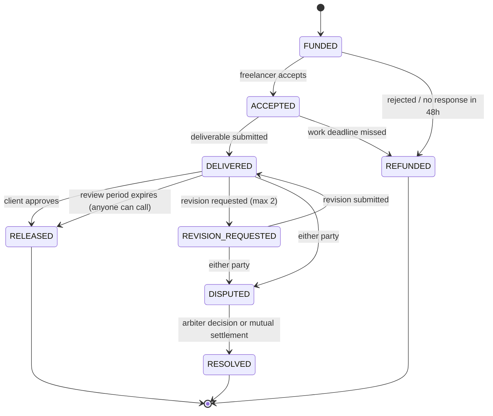

# NEAR Escrow

**Escrow for freelancers, enforced by a smart contract.** A client locks the money before work starts. The freelancer gets paid when the work is approved. If they disagree, a human arbiter both sides agreed on decides — and nobody in the middle ever holds the funds.

> NEAR Hackathon 2026 · track: `realworld` (with `agents` if the AI dispute summary ships)

---

## The problem

A freelancer in Bandung takes a contract from a client in Berlin. Both sides are exposed:

| Who | What they risk |
|---|---|
| Client | Paying upfront and receiving nothing, or something that does not match the brief. |
| Freelancer | Doing the work and not getting paid — or getting paid through a platform that takes 3–7% and a bad exchange rate. |
| Both | When it goes wrong, there is no shared rulebook and no neutral party. |

Large freelance platforms solve this by taking a big cut and holding the money themselves. This project solves it by putting the rules in code and the money in a contract that neither party controls.

## How it works

1. **Client creates a project** — freelancer, arbiter, brief, deadline, and the escrow amount is deposited in the same transaction.
2. **Freelancer accepts** (within 48h) or rejects, which refunds the client.
3. **Freelancer submits** a deliverable link before the deadline.
4. **Client approves** (funds released), **requests a revision** (max 2, each adds 3 days), or **opens a dispute** within the 72-hour review window.
5. **Silence is not a trap** — if the client does nothing for 72 hours, anyone can trigger release to the freelancer.
6. **Dispute** — funds freeze. Both sides submit evidence. The arbiter sets the split (0–100%). Both sides can also settle mutually at any percentage they both accept.
7. **Withdraw** — allocated funds are pulled by each recipient to their own wallet.



### Why "withdraw" is a separate step

Settlement writes an **allocation**, it does not push money. Each recipient then withdraws their own balance. This is deliberate: a transfer that fails (insufficient gas, a locked account) can never roll back or corrupt a settlement decision that was already agreed on-chain. The recipient simply retries.

## What makes this different

1. **No third party holds the money.** Not us, not a platform — a contract. There is no admin key that can move user funds.
2. **The dispute process is public.** Evidence, arbiter decision, and the exact split are on-chain and readable by anyone, forever.
3. **Reputation cannot be faked.** A freelancer's completed projects, total value, and dispute history are derived from contract state, not from a profile the user edits.

## Tech stack

| Layer | Choice |
|---|---|
| Smart contract | Rust · `near-sdk` 5.30 · NEAR Testnet |
| Frontend | React 19 · TypeScript · Vite · `near-wallet-selector` |
| AI dispute summary (optional) | Serverless function calling an LLM — advisory only, never touches funds or the contract |

## Repository layout

```
contract/     Rust smart contract (near-sdk)
app/          React frontend + the optional AI endpoint
docs/         Specification set (read these in order, see below)
```

## Documentation

The project is spec-first: the contract is a direct implementation of these documents, and every design decision with a trade-off is recorded in a Decisions Record inside them.

| # | Document | What it answers |
|---|---|---|
| 00 | [PRD](docs/PRD%20NEAR%20Escrow%20untuk%20Freelancer.md) | Problem, target users, scope, demo script |
| 01 | [FSD](docs/FUNCTIONAL%20SPECIFICATION%20DOCUMENT%20(FSD).md) | Business rules, roles, error codes, acceptance criteria |
| 02 | [STS](docs/State%20Transition%20Specification%20(STS).md) | Every status and every legal transition |
| 03 | [SCTS](docs/Smart%20Contract%20Technical%20Specification%20(SCTS).md) | Data model, methods, fund accounting, security invariants |
| 04 | [SAS](docs/System%20Architecture%20Specification%20(SAS).md) | Components, deployment, wallet and transaction lifecycle |
| 05 | [Test Plan](docs/Test%20Plan%20and%20Test%20Cases.md) | 138 test cases, mapped to every rule and error code |
| 06 | [Integration Spec](docs/API%20and%20Frontend%20Integration%20Specification.md) | Contract ↔ frontend contract, action eligibility, error mapping |

## Status

Honest snapshot — this README will be updated as pieces land.

- [x] Specification set complete (v1.5), reviewed across five audit passes
- [ ] Smart contract implementation
- [ ] Contract test suite (138 cases, 102 mandatory)
- [ ] Testnet deployment
- [ ] Frontend
- [ ] AI dispute summary (optional)
- [ ] Demo video

**Contract address (testnet):** not deployed yet.

## Running locally

Not available yet — the contract and app are still being implemented. Once they land, this section will contain the exact commands to build the contract, deploy to testnet, and run the frontend.

## Scope boundaries

Deliberately **not** in this version: milestone payments, a freelancer marketplace, in-app chat, fiat/bank withdrawal, platform fees, and any admin power over user funds.

## Known limitation

If the arbiter goes silent for more than 7 days and the two parties cannot agree on a mutual settlement, funds stay locked. This is documented rather than hidden: the alternative — letting an operator force a split — would hand one key the power the whole product exists to remove. It is stated in the UI and in [FSD §10.3](docs/FUNCTIONAL%20SPECIFICATION%20DOCUMENT%20(FSD).md).
