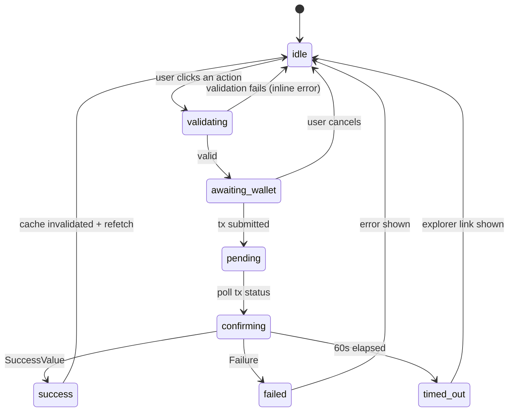

# API AND FRONTEND INTEGRATION SPECIFICATION

**Project:** NEAR Escrow
**Document Version:** 1.5 — Final
**Status:** Approved
**Date:** November 8, 2026
**Revision:** v1.4 from the fourth audit: `createProjectSchema` now receives `nowNanos` from the chain clock instead of calling `Date.now()` (which contradicted §7.3 / I-P6), all thresholds come from `get_config()` rather than hardcoded literals, and the undefined `ACCEPT_WINDOW_NS` constant is gone. v1.3 from the third audit: `workDeadline` is `z.string()` and must be at least one acceptance window away, `createProjectSchema` takes the client id as an argument (the `v.me` refine was a silent no-op), the pre-transaction table spells out all three pairwise identity checks, and `E-10` copy covers deliverables as well as dispute evidence. v1.2 from the second independent audit: `Role` documented as lowercase on the wire in both directions (D-18), `set_paused` removed from the app write table and recorded as a CLI operation, the AccountId validator replaced with one that accepts implicit accounts and checks all three roles are distinct, `E-22` added, and the error range/counters updated to 22. v1.1: `release_after_review` added for client and freelancer in the eligibility matrix (§8), error codes E-20/E-21 added and E-10 narrowed (§9), per-project amounts relabelled "allocated" (§12.6, SCTS §6.3), and `open_dispute` shown as time-unlimited in `RevisionRequested` (§8, STS D-01).
**Based on:** FSD v1.5 · STS v1.5 · SCTS v1.5 · SAS v1.5 · Test Plan v1.5
**Network:** NEAR Testnet

---

# 1. Purpose and Scope

This document is the working contract between the frontend and the smart contract. It answers: which functions are called, with which arguments, what they return, when they are called, how failures are presented, and which buttons may appear on which screen.

In scope:

1. Configuration and client initialisation.
2. TypeScript types for all contract data.
3. Amount conversion rules (yoctoNEAR ↔ NEAR).
4. Specification of every view call and write call: signature, arguments, gas, deposit, cache effects.
5. Action eligibility matrix (status × role × time) — the single source of truth for UI buttons.
6. Mapping of error codes E-01…E-22 to UI messages.
7. Transaction state model and per-page states.
8. The AI endpoint contract from the client's perspective.
9. Per-page specification.
10. Frontend acceptance criteria (mapped directly to UI-01…UI-15 and CP…RF).

Out of scope: visual design, full implementation code, and business rules (already defined in FSD/SCTS).

---

# 2. Integration Principles

| # | Principle | Consequence |
|---|---|---|
| I-P1 | **One place for all contract calls** | No `contract.functionCall(...)` is ever written inside a component. Everything goes through `lib/near/contract.ts`. |
| I-P2 | **Amounts are always `BigInt`** | Never `Number` or `parseFloat` for money. Conversion happens only in `lib/format.ts`. |
| I-P3 | **Transaction success is not UI success** | After a successful transaction the app must refetch. No state is invented locally. |
| I-P4 | **UI guards are cosmetic** | The contract remains the final authority. The UI hides impossible actions but never considers itself authoritative. |
| I-P5 | **Errors are mapped, never forwarded raw** | Every `E-xx` has a human sentence plus a suggested action. |
| I-P6 | **Countdowns use chain time** | The device clock offset is computed once per session and applied to every countdown. |
| I-P7 | **Identifiers and UI copy are English** | All code identifiers, types, field names, comments and user-facing copy are English. |

---

# 3. Configuration and Initialisation

## 3.1 Environment

```ts
// src/config/env.ts
export const ENV = {
  networkId: import.meta.env.VITE_NETWORK_ID as 'testnet',
  contractId: import.meta.env.VITE_CONTRACT_ID as string,
  rpcUrl: import.meta.env.VITE_RPC_URL as string,
  aiEndpoint: import.meta.env.VITE_AI_ENDPOINT as string | undefined,
  explorerUrl: import.meta.env.VITE_EXPLORER_URL as string,
} as const;

// hard guard: mainnet is refused (SAS S-4)
if (ENV.networkId !== 'testnet') {
  throw new Error('This application only supports NEAR testnet.');
}
if (!ENV.contractId) {
  throw new Error('VITE_CONTRACT_ID is required.');
}
```

## 3.2 Selector and Client Initialisation

```ts
// src/lib/near/setup.ts
let selectorPromise: Promise<WalletSelector> | null = null;

export function getSelector(): Promise<WalletSelector> {
  if (!selectorPromise) {
    selectorPromise = setupWalletSelector({ network, modules });
  }
  return selectorPromise;
}

// src/lib/near/contract.ts
export async function getContract(): Promise<Contract> {
  const selector = await getSelector();
  const wallet = await selector.wallet();
  return new Contract({
    contractId: ENV.contractId,
    provider: new JsonRpcProvider({ url: ENV.rpcUrl }),
    signer: wallet, // FunctionCall access only
  });
}
```

Rules:

1. `getSelector()` must be a singleton. Two selector instances produce two wallet popups.
2. `getContract()` is called per action, never cached globally — the account can change.
3. When `accountId` changes, every query is invalidated (§10.3).

## 3.3 Gas and Deposit Defaults

| Constant | Value | Used for |
|---|---|---|
| `GAS_DEFAULT` | 30 Tgas | All non-payable methods except withdraw |
| `GAS_WITHDRAW` | 50 Tgas | `withdraw` (contract requires ≥ 30) |
| `GAS_CREATE` | 30 Tgas | `create_project` |
| `DEPOSIT_CREATE` | = amount | `create_project` (SCTS D-06: deposit *is* the escrow) |
| `DEPOSIT_TOPUP` | donation amount | `top_up_reserve` |
| `DEPOSIT_ZERO` | `0n` | All non-payable methods |

**Important:** `GAS_WITHDRAW` is 50 Tgas, not 30. The contract rejects anything below 30 Tgas, and the surplus is needed for the `on_withdraw` callback. Using exactly 30 Tgas risks a callback that runs out of gas (SCTS §8.4, WD-05).

---

# 4. Data Types

## 4.1 Type Source

```ts
// src/types/contract.ts
export type U128 = string;   // sent by the contract as a string
export type U64  = string;
export type Nanos = string;  // u64 timestamp serialised as a string

export type ProjectStatus =
  | 'Funded' | 'Accepted' | 'Delivered' | 'RevisionRequested'
  | 'Disputed' | 'Released' | 'Refunded' | 'Resolved';

export type Role = 'client' | 'freelancer' | 'arbiter';

export interface Deliverable {
  link: string;
  note: string;
  submitted_at: Nanos;
  revision_index: number;
}

export interface Evidence {
  link: string;
  note: string;
  submitted_at: Nanos;
}

export interface Resolution {
  freelancer_percent: number;
  resolved_by: 'Arbiter' | 'MutualSettlement';
  resolved_at: Nanos;
}

export interface Distribution {
  freelancer_amount: U128;
  client_amount: U128;
}

export interface Project {
  id: number;
  client: string;
  freelancer: string;
  arbiter: string;
  title: string;
  description: string;
  amount: U128;
  status: ProjectStatus;
  created_at: Nanos;
  accept_deadline: Nanos;
  work_deadline: Nanos;
  review_deadline: Nanos | null;
  revision_deadline: Nanos | null;
  dispute_opened_at: Nanos | null;
  revision_count: number;
  deliverable: Deliverable | null;
  client_evidence: Evidence | null;
  freelancer_evidence: Evidence | null;
  client_settlement_proposal: number | null;
  freelancer_settlement_proposal: number | null;
  resolution: Resolution | null;
  distribution: Distribution | null;
}

export interface Stats {
  projects_as_client: number;
  projects_as_freelancer: number;
  completed_as_freelancer: number;
  total_value_as_freelancer: U128;
  disputes_as_freelancer: number;
  disputes_released_fully: number;
  refunds_as_client: number;
}

export interface Config {
  owner: string;
  min_escrow: U128;
  accept_window: Nanos;
  review_window: Nanos;
  revision_extension: Nanos;
  arbiter_window: Nanos;
  max_revisions: number;
  paused: boolean;
}

export interface FundInvariants {
  locked: U128;
  claimable: U128;
  balance: U128;
  storage_stake: U128;
  ok: boolean;
}

export interface WithdrawalRecord {
  amount: U128;
  started_at: Nanos;
}

export interface ProjectClaim {
  project_id: number;
  role: Role;   // wire format is lowercase (SCTS D-18); get_projects also accepts 'arbiter'
  allocated: U128;   // historical allocation, NOT a remaining balance
  status: ProjectStatus;
}
```

## 4.2 Type Rules

1. All large numbers arrive from the contract as **strings** (`U128`, `U64`). Never `JSON.parse` them into numbers.
2. `ProjectStatus` is serialised as a PascalCase string (`"Funded"`), not a number, because the contract uses `#[near(serializers = [borsh, json])]`.
3. Nullable concepts (`review_deadline = 0`, `dispute_opened_at = 0`) are mapped to `null` in the adapter layer rather than leaked as raw `0`.
4. `deadline === 0` **always** means "not applicable". The `isApplicable(nanos)` helper must be checked before any time comparison.
5. `resolution` is `null` for `Released` and `Refunded`. Those statuses are reached by rule, not by a decision, so no arbiter or settlement is recorded (SCTS D-11). Render the "decided by" block only when `resolution !== null`.
6. `ProjectClaim.allocated` is a historical allocation. It does **not** shrink when the account withdraws, and it is **0 until a settlement writes a distribution**. Never sum it and present it as withdrawable (SCTS §6.3), and never render it as the project's value — that is `amount` from `get_project`.
7. The contract guarantees these fields arrive as **strings** (`U128`/`U64`, SCTS D-15). If a number ever arrives, that is a contract regression: log it and fall into the page's error state instead of silently `String()`-ing a value that may already be truncated. The adapter's `String()` is a safety net, not a conversion step.
8. `role` in `get_projects` and in `ProjectClaim` is lowercase (`"client" | "freelancer" | "arbiter"`), matching `#[serde(rename_all = "lowercase")]` on the contract enum (SCTS D-18). Do not send `"Client"`.

## 4.3 Adapter

```ts
// src/lib/near/adapter.ts
export function toProject(raw: any): Project {
  const nz = (v: any) => (v === '0' || v === 0 || v == null ? null : String(v));
  return {
    ...raw,
    amount: String(raw.amount),
    review_deadline: nz(raw.review_deadline),
    revision_deadline: nz(raw.revision_deadline),
    dispute_opened_at: nz(raw.dispute_opened_at),
  } as Project;
}
```

Every component receives a `Project` produced by the adapter, never a raw RPC object. This is the single place to fix serialisation differences.

---

# 5. View Call Specification

## 5.1 View Catalogue

| Method | TypeScript signature | Returns | Used by |
|---|---|---|---|
| `get_project` | `(id: number) => Promise<Project \| null>` | one project | Detail, Dispute |
| `get_projects` | `(account: string, role: Role, from: number, limit: number) => Promise<Project[]>` | list | Dashboard |
| `get_claimable` | `(account: string) => Promise<U128>` | string | Header, Profile, Detail |
| `get_claimable_per_project` | `(account: string) => Promise<ProjectClaim[]>` | list | Profile |
| `get_project_count` | `() => Promise<number>` | number | Landing |
| `get_stats` | `(account: string) => Promise<Stats>` | object | Profile |
| `get_config` | `() => Promise<Config>` | object | Global (once) |
| `get_fund_invariants` | `() => Promise<FundInvariants>` | object | Admin |
| `get_withdrawal_state` | `(account: string) => Promise<WithdrawalRecord \| null>` | object | Profile |
| `get_state_version` | `() => Promise<number>` | number | Admin |

## 5.2 View Implementation Example

```ts
// src/lib/near/contract.ts
export async function viewGetProject(id: number): Promise<Project | null> {
  const provider = new JsonRpcProvider({ url: ENV.rpcUrl });
  const raw = await provider.query({
    request_type: 'call',
    finality: 'final',
    account_id: ENV.contractId,
    method_name: 'get_project',
    args_base64: btoa(JSON.stringify({ project_id: id })),
  });
  const text = Buffer.from((raw as any).result).toString('utf8');
  const value = JSON.parse(text);
  return value ? toProject(value) : null;
}
```

View rules:

1. View calls **never** require a wallet. Detail pages are readable without connecting.
2. Any view whose data drives button decisions uses `finality: 'final'`, so the UI never reads unfinalised state.
3. Every view call is wrapped in TanStack Query; no manual `useEffect` fetching.

## 5.3 Pagination

| Screen | `limit` | Strategy |
|---|---|---|
| Dashboard | 20 | "Load more" button (`from_index` += 20) |
| Profile (stats) | — | Not paginated; the contract aggregates the whole history |
| Detail | — | Single object |

Hard contract limit: `limit ≤ 50`. The frontend must never exceed it.

---

# 6. Write Call Specification

## 6.1 Write Call Table

| Method | Arguments | Gas | Deposit | Cache effect |
|---|---|---|---|---|
| `create_project` | `{ freelancer, arbiter, title, description, work_deadline }` | 30 Tgas | **= amount** | invalidate `projects`, `claimable`, `count` |
| `accept_project` | `{ project_id }` | 30 | 0 | invalidate `project`, `projects` |
| `reject_project` | `{ project_id }` | 30 | 0 | invalidate `project`, `claimable`, `projects` |
| `claim_no_response_refund` | `{ project_id }` | 30 | 0 | invalidate `project`, `claimable` |
| `claim_deadline_refund` | `{ project_id }` | 30 | 0 | invalidate `project`, `claimable` |
| `submit_deliverable` | `{ project_id, link, note }` | 30 | 0 | invalidate `project` |
| `approve_deliverable` | `{ project_id }` | 30 | 0 | invalidate `project`, `claimable`, `stats` |
| `request_revision` | `{ project_id }` | 30 | 0 | invalidate `project` |
| `release_after_review` | `{ project_id }` | 30 | 0 | invalidate `project`, `claimable`, `stats` |
| `open_dispute` | `{ project_id }` | 30 | 0 | invalidate `project`, `projects` |
| `submit_evidence` | `{ project_id, link, note }` | 30 | 0 | invalidate `project` |
| `arbiter_resolve` | `{ project_id, freelancer_percent }` | 30 | 0 | invalidate `project`, `claimable`, `stats` |
| `propose_settlement` | `{ project_id, freelancer_percent }` | 30 | 0 | invalidate `project` |
| `settle_mutual` | `{ project_id, freelancer_percent }` | 30 | 0 | invalidate `project`, `claimable`, `stats` |
| `withdraw` | `{}` | **50** | 0 | invalidate `claimable`, wallet balance |
| `top_up_reserve` | `{}` | 30 | donation | invalidate `fund_invariants` |
| ~~`set_paused`~~ | — | — | — | **Not called by the app.** Pause is an operator CLI action (SCTS M-18); `/admin` stays read-only per D-09. Documented here so nobody expects a toggle in the UI. |

## 6.2 Single Call Helper

```ts
// src/lib/near/contract.ts
interface CallOpts {
  method: string;
  args: Record<string, unknown>;
  gas?: string;
  deposit?: bigint;
}

export async function callMethod(opts: CallOpts): Promise<TxOutcome> {
  const selector = await getSelector();
  const wallet = await selector.wallet();
  const accounts = selector.store.getState().accounts;
  if (accounts.length === 0) throw new NotConnectedError();

  const outcome = await wallet.signAndSendTransaction({
    receiverId: ENV.contractId,          // verified, never taken from UI state
    actions: [
      {
        type: 'FunctionCall',
        params: {
          methodName: opts.method,
          args: opts.args,
          gas: opts.gas ?? '30000000000000',       // 30 Tgas
          deposit: (opts.deposit ?? 0n).toString(),
        },
      },
    ],
  });

  return { hash: outcome.transaction_outcome.id };
}
```

## 6.3 Special Case: `create_project`

`create_project` needs the escrow value attached. That value travels as the **`deposit` field of the `FunctionCall` action** — it is not a separate `Transfer` action.

```ts
export async function createProject(input: CreateProjectInput) {
  const amountYocto = nearToYocto(input.amountNear);   // BigInt
  const wallet = (await getSelector()).wallet();

  return wallet.signAndSendTransaction({
    receiverId: ENV.contractId,
    actions: [
      {
        type: 'FunctionCall',
        params: {
          methodName: 'create_project',
          args: {
            freelancer: input.freelancer,
            arbiter: input.arbiter,
            title: input.title,
            description: input.description,
            work_deadline: String(input.workDeadline),   // u64 as string
          },
          gas: '30000000000000',
          deposit: amountYocto.toString(),
        },
      },
    ],
  });
}
```

**Critical rule — do not add a separate `Transfer` action.** A `FunctionCall` action with a non-zero `deposit` already transfers that NEAR to the receiver. Sending `[Transfer(amount), FunctionCall(deposit=amount)]` transfers the escrow **twice**, and no contract-side check can prevent it because the extra funds simply arrive as an unsolicited balance. One action, one deposit.

> Note: this supersedes the illustrative snippet in SAS §5.2, which showed both actions. That snippet was wrong and has been corrected there.

## 6.4 Pre-Transaction Validation

Runs **before** the wallet opens, so the user never pays gas for an avoidable mistake:

| Method | Required validation |
|---|---|
| `create_project` | `freelancer ≠ arbiter`, `freelancer ≠ client`, `arbiter ≠ client` (all three, not just the first pair); valid AccountId format; `amount >= min_escrow` (from `get_config`); **`work_deadline >= now + accept_window`** (48h, from `get_config`) — not merely `> now`; title 1–128 bytes; description 1–2000 bytes |
| `submit_deliverable` | link non-empty (≤ 512 bytes); note ≤ 1024 bytes; deadline still valid |
| `submit_evidence` | link non-empty; note ≤ 1024 bytes |
| `arbiter_resolve` / `propose_settlement` / `settle_mutual` | `0 ≤ percent ≤ 100`, integer |
| `withdraw` | `claimable > 0` |

Zod schema (example):

```ts
// Accepts BOTH implicit (64 hex chars) and named accounts, matching the contract's
// AccountId rules (SCTS §7.3, item 2). A named-only regex rejects implicit accounts and
// would block a legitimate user before the wallet ever opens.
export const accountIdSchema = z.string().refine((v) => {
  if (/^[0-9a-f]{64}$/.test(v)) return true;                       // implicit
  return /^(([a-z\d]+[-_])*[a-z\d]+\.)*[a-z\d]+[-_]*[a-z\d]+\.(testnet|near)$/.test(v); // named
}, { message: 'Enter a valid NEAR account ID (e.g. alice.testnet).' });

// Values the form cannot know come in as arguments. Two traps this avoids:
//  - `clientId`: a refine reading `v.me` compares against `undefined`, and
//    {freelancer, arbiter, undefined} has size 3, so the check would always pass.
//  - `nowNanos`: using `Date.now()` here breaks §7.3 / I-P6. A device clock two hours
//    fast lets a 47-hour deadline through, opens the wallet, and the contract rejects
//    it with E-03 — the user pays for that mistake in gas.
// Nothing here is hardcoded: minEscrow and acceptWindowNs come from get_config().
export const createProjectSchema = (params: {
  clientId: string;
  minEscrowYocto: bigint;   // BigInt(get_config().min_escrow)
  acceptWindowNs: bigint;   // BigInt(get_config().accept_window)
  nowNanos: bigint;         // useChainClock().nowNanos()
}) =>
  z.object({
    freelancer: accountIdSchema,
    arbiter: accountIdSchema,
    title: z.string().min(1).max(128),
    description: z.string().min(1).max(2000),
    amountNear: z.string().refine(
      v => nearToYocto(v) >= params.minEscrowYocto,
      { message: `The amount must be at least ${formatNear(params.minEscrowYocto)}.` },
    ),
    // String on the wire: the contract takes U64 (SCTS D-22). Sending a JS number
    // fails deserialisation, and a number above 2^53 would already be lossy.
    workDeadline: z.string().regex(/^\d+$/, 'A deadline is required.'),
  })
    .refine(v => new Set([v.freelancer, v.arbiter, params.clientId]).size === 3, {
      message: 'The client, freelancer and arbiter must be three different accounts.',
    })
    .refine(
      v => BigInt(v.workDeadline) >= params.nowNanos + params.acceptWindowNs,
      { message: 'The work deadline must be at least 48 hours away.', path: ['workDeadline'] },
    );
```

---

# 7. Amount and Time Rules

## 7.1 Conversion

```ts
// src/lib/format.ts
export const YOCTO_PER_NEAR = 10n ** 24n;

export function nearToYocto(near: string): bigint {
  const [intPart, fracRaw = ''] = near.trim().split('.');
  if (!/^\d+$/.test(intPart)) throw new Error('Invalid NEAR amount');
  const frac = (fracRaw + '0'.repeat(24)).slice(0, 24);
  if (!/^\d*$/.test(fracRaw)) throw new Error('Invalid NEAR amount');
  return BigInt(intPart) * YOCTO_PER_NEAR + BigInt(frac || '0');
}

export function yoctoToNear(yocto: string | bigint): string {
  const v = BigInt(yocto);
  const whole = v / YOCTO_PER_NEAR;
  const frac = (v % YOCTO_PER_NEAR).toString().padStart(24, '0');
  const trimmed = frac.replace(/0+$/, '');
  return trimmed ? `${whole}.${trimmed}` : `${whole}`;
}

export function formatNear(yocto: string, maxFrac = 4): string {
  const s = yoctoToNear(yocto);
  const [w, f = ''] = s.split('.');
  return f ? `${w}.${f.slice(0, maxFrac)} NEAR` : `${w} NEAR`;
}
```

Rules:

1. **Forbidden:** `Number()`, `parseFloat`, or ordinary JS arithmetic on yoctoNEAR. `Number.MAX_SAFE_INTEGER` is far below typical NEAR amounts.
2. User input is accepted as a string; conversion to `BigInt` happens only inside `nearToYocto`.
3. Display uses `formatNear` with at most 4 decimals, but the **value sent is always exact**.
4. Never show yoctoNEAR to a user.

## 7.2 Time

```ts
export const NS_PER_MS = 1_000_000n;

export function nanosToDate(nanos: string): Date {
  return new Date(Number(BigInt(nanos) / NS_PER_MS));
}

export function formatDeadline(nanos: string, nowNanos: bigint): string {
  // "in 3 days", "in 4 hours", "expired 12 minutes ago"
}

export function isExpired(deadline: string | null, nowNanos: bigint): boolean {
  return deadline !== null && nowNanos >= BigInt(deadline);
}
```

## 7.3 Clock Synchronisation

Problem: a user's device clock can be off by minutes or hours. A wrong countdown makes a button appear active while the contract rejects it — which reads as a bug in front of an audience.

Solution: once per session, read the latest block timestamp from RPC, compute the offset, and use it everywhere.

```ts
// src/hooks/useChainClock.ts
export function useChainClock() {
  const { data: offsetMs } = useQuery({
    queryKey: ['clock-offset'],
    queryFn: async () => {
      const block = await rpcProvider.block({ finality: 'final' });
      const chainMs = Number(BigInt(block.header.timestamp) / NS_PER_MS);
      return chainMs - Date.now();
    },
    staleTime: 60_000,
  });

  const nowNanos = () => BigInt(Date.now() + (offsetMs ?? 0)) * NS_PER_MS;
  return { nowNanos };
}
```

Rule: every button decision (`isExpired`, `canRequestRevision`, …) uses `nowNanos()`, never `Date.now()` directly.

---

# 8. Action Eligibility Matrix

This is the **single source of truth** for which buttons exist. It is implemented as one pure function, tested separately:

```ts
export function availableActions(
  project: Project,
  me: string | null,
  nowNanos: bigint,
  config: Config,
): Action[]
```

Rows are the caller's role; columns are the project status.

| Status | Client | Freelancer | Arbiter | Anyone else |
|---|---|---|---|---|
| `Funded` | `claim_no_response_refund` (if `now >= accept_deadline`), `withdraw` (if claimable) | `accept_project`, `reject_project` (if `now < accept_deadline`) | — | `withdraw` (if claimable) |
| `Accepted` | `claim_deadline_refund` (if `now >= work_deadline`) | `submit_deliverable` (if `now < work_deadline`) | — | — |
| `Delivered` | `approve_deliverable`, `request_revision` (if `revision_count < 2`), `open_dispute` — all only while `now < review_deadline`; **plus** `release_after_review` once `now >= review_deadline` | `open_dispute` (if `now < review_deadline`); **plus** `release_after_review` once `now >= review_deadline` | — | `release_after_review` (if `now >= review_deadline`) |
| `RevisionRequested` | `open_dispute` (no time limit, even after the revision deadline) | `submit_deliverable` (if `now < revision_deadline`), `open_dispute` (no time limit) | — | — |
| `Disputed` | `submit_evidence` (if not yet submitted), `propose_settlement`, `settle_mutual` | `submit_evidence` (if not yet submitted), `propose_settlement`, `settle_mutual` | `arbiter_resolve` (if `now <= dispute_opened_at + arbiter_window`) | — |
| `Released` | `withdraw` (if claimable) | `withdraw` (if claimable) | — | — |
| `Refunded` | `withdraw` (if claimable) | — | — | — |
| `Resolved` | `withdraw` (if claimable) | `withdraw` (if claimable) | — | — |

Additional rules:

1. `release_after_review` is callable by **anyone**, including the client and freelancer. The UI shows it as a secondary action labelled "Release to freelancer (review period ended)".
2. `withdraw` is driven by `claimable > 0`, not by project status. It never waits for a specific status.
3. `/admin` is restricted to `config.owner` and is read-only. `set_paused` is executed from the CLI by the operator, not from the app (§6.1).
4. When no action is available, the UI shows the reason ("Waiting for the freelancer to submit. Review period ends in 2 days.") instead of an empty area.
5. Actions already taken render as status text, not buttons (e.g. after `submit_evidence`: "Evidence submitted").

## 8.1 Button Labels

| Action | Label | Style |
|---|---|---|
| `create_project` | Create project | Primary |
| `accept_project` | Accept project | Primary |
| `reject_project` | Reject project | Destructive |
| `submit_deliverable` | Submit deliverable | Primary |
| `approve_deliverable` | Approve & release funds | Primary |
| `request_revision` | Request revision | Secondary |
| `open_dispute` | Open dispute | Destructive |
| `submit_evidence` | Submit evidence | Secondary |
| `arbiter_resolve` | Decide distribution | Primary |
| `propose_settlement` | Propose split | Secondary |
| `settle_mutual` | Accept split | Primary |
| `release_after_review` | Release to freelancer | Secondary |
| `claim_no_response_refund` | Claim refund | Secondary |
| `claim_deadline_refund` | Claim refund | Secondary |
| `withdraw` | Withdraw {amount} NEAR | Primary |

## 8.2 Confirmation Dialogs

Mandatory for irreversible actions:

| Action | Dialog copy |
|---|---|
| `approve_deliverable` | "Release {amount} NEAR to {freelancer}? This cannot be undone." |
| `arbiter_resolve` | "Send {f}% ({amount} NEAR) to the freelancer and {c}% to the client? This is final." |
| `settle_mutual` | "Both parties agree to {p}%. This is final." |
| `reject_project` | "Reject this project and return {amount} NEAR to the client?" |
| `withdraw` | "Withdraw {amount} NEAR to your wallet?" |

---

# 9. Error Mapping

The contract returns errors shaped like `"E-XX: message"`. The frontend maps by code.

**Read the code, not the string.** A failed call never arrives bare. The RPC wraps it, and the wrapper text is not part of the contract's interface:

```
Smart contract panicked: E-18: nothing to withdraw
```

Two consequences for the adapter:

1. Extract with `raw.match(/E-\d{2}/)` and map that. Never compare the whole message, and never match on the human sentence — the wording may change while the code is frozen.
2. Anything without an `E-\d{2}` (a bare `WebAssembly trap`, a timeout, a wallet rejection) must fall through to the `(unknown)` row. A contract deployed without `cfg(near)` produces exactly that for **every** error, so this fallback is also the symptom to look for when all failures suddenly become generic (see SCTS D-26).

Payments are never pushed by the contract, so `E-12` cannot be returned from a settlement call: a failed transfer surfaces on the `withdraw` callback and restores the balance. The user's fix is always "withdraw again", not "reopen the dispute".

| Code | UI message | Suggested action |
|---|---|---|
| E-01 | You are not allowed to do this for this project. | Connect with the correct account. |
| E-02 | This action is not possible in the project's current state. | Refresh the page. |
| E-03 | The deadline for this action has passed. | See the project timeline. |
| E-04 | The escrow amount is invalid. | Amount must be at least {min_escrow} NEAR. |
| E-05 | The project has already been accepted. | Refresh. |
| E-06 | You have used both available revisions. | Open a dispute instead. |
| E-07 | A dispute is already active for this project. | — |
| E-08 | This project is already finalized. | — |
| E-09 | The percentage must be between 0 and 100. | — |
| E-10 | The link or note you submitted is not valid. | A link is required and must be under 512 characters; notes are capped at 1024. This covers both deliverables and dispute evidence. |
| E-11 | The review period has not ended yet. | Try again after {review_deadline}. |
| E-12 | The payout transfer failed. Your balance was restored. | Try withdrawing again. |
| E-13 | The arbiter's 7-day decision window has ended. | Use mutual settlement with the other party. |
| E-14 | The contract's storage reserve is insufficient. | Contact the operator. Your funds are safe. |
| E-15 | New projects are temporarily paused. | Try again later. |
| E-16 | Settlement requires both parties to agree on the same percentage. | Check the other party's proposal. |
| E-17 | This withdrawal is still pending. Wait before clearing it. | — |
| E-18 | You have nothing to withdraw. | — |
| E-19 | A withdrawal is already in progress for your account. | Wait a few seconds. |
| E-20 | A dispute cannot be opened at this stage. | You can only dispute after the work has been submitted. |
| E-21 | This project does not exist. | Check the link or return to your dashboard. |
| E-22 | There is no pending withdrawal to clear. | *(operator/CLI only — not reachable from the app UI)* |
| (unknown) | Something went wrong while communicating with the contract. | Detail: {raw} |

Rules:

1. The code is always available in an expandable detail — never hidden entirely (it helps QA and judges).
2. Messages are never just "Something went wrong" (FSD §7).
3. Wallet errors are handled separately from contract errors:

| Source | Examples | Treatment |
|---|---|---|
| User rejection | `UserRejected`, `User denied` | Neutral info toast: "Transaction cancelled." |
| Wallet / network | `Timeout`, `Network error` | Warning toast + Retry button + explorer link |
| Contract | `E-xx` | Error toast with the mapped message |

---

# 10. State Model

## 10.1 Transaction State



```ts
type TxState =
  | { phase: 'idle' }
  | { phase: 'awaiting_wallet' }
  | { phase: 'pending'; hash: string }
  | { phase: 'success'; hash: string }
  | { phase: 'failed'; hash?: string; error: MappedError }
  | { phase: 'timed_out'; hash: string };
```

Rules:

1. One `TxState` per page. While in `pending` or `awaiting_wallet`, all action buttons are disabled to prevent double submission.
2. `success` never renders new data before the refetch completes — show a skeleton instead.
3. Navigation is never blocked while `pending`; the user may leave the page.

## 10.2 Per-Page States

| Page | Loading | Empty | Error | Success |
|---|---|---|---|---|
| `/` Landing | Stats skeleton | "No projects yet. Be the first." | Banner "Unable to reach the contract" + Retry | Stats + CTA |
| `/create` | Config pending → spinner on the button | — | Inline per field | Redirect to detail |
| `/dashboard` | List skeleton | "You have no projects as {role}." + create CTA | Banner + Retry | List + role tabs |
| `/project/:id` | Detail skeleton | — | 404: "Project not found" + dashboard link | Full detail + actions |
| `/dispute/:id` | Skeleton | — | "Project is not in dispute" + redirect | Evidence panel + arbiter + AI |
| `/profile/:account` | Skeleton | "No activity yet." | Banner + Retry | Stats + claimable + withdraw |
| `/admin` | Skeleton | — | "You are not the contract owner." | Invariants + config |

## 10.3 Query Keys

```ts
const qk = {
  project: (id: number) => ['project', id] as const,
  projects: (acct: string, role: Role) => ['projects', acct, role] as const,
  claimable: (acct: string) => ['claimable', acct] as const,
  stats: (acct: string) => ['stats', acct] as const,
  config: () => ['config'] as const,
  invariants: () => ['fund_invariants'] as const,
  withdrawal: (acct: string) => ['withdrawal', acct] as const,
  walletBalance: (acct: string) => ['wallet_balance', acct] as const,
  clockOffset: () => ['clock-offset'] as const,
};
```

After a successful transaction, invalidate only what §6.1 lists — not "invalidate everything", which causes UI-wide flicker.

---

# 11. AI Endpoint from the Client

## 11.1 Types

```ts
export interface DisputeSummaryRequest {
  project: {
    id: number; title: string; description: string;
    amount_near: string; work_deadline: string; revisions: number;
  };
  deliverable: { link: string; note: string };
  evidence: {
    client: { link: string; note: string };
    freelancer: { link: string; note: string };
  };
}

export interface DisputeSummaryResponse {
  summary: string;
  client_position: string;
  freelancer_position: string;
  matches: string[];
  mismatches: string[];
  suggested_split: { freelancer_percent: number; client_percent: number };
  confidence: 'low' | 'medium' | 'high';
  disclaimer: string;
}
```

## 11.2 Client Flow

1. The "Generate AI summary" button is enabled **only** when both parties have submitted evidence and `VITE_AI_ENDPOINT` is configured.
2. The request uses an `AbortController` with a 20-second timeout.
3. The response is validated with Zod against `DisputeSummaryResponse`. Invalid responses are treated as failures.
4. The disclaimer is **always** rendered and cannot be permanently dismissed.
5. This button never triggers a transaction. There is no path from a summary to `arbiter_resolve`.

## 11.3 Fallbacks

| Condition | UI |
|---|---|
| Endpoint not configured | The AI button is not rendered at all |
| Endpoint error or timeout | "AI summary unavailable. You can still decide based on the evidence." |
| Rate limited (429) | "Too many requests. Try again in a minute." |
| Invalid response | "AI returned an unexpected response." |

---

# 12. Page Specifications

## 12.1 `/` Landing

- Data: `get_project_count()`, optional sample `get_stats(account)`.
- Actions: CTA "Create escrow" (→ `/create`), "View a project" (ID input).
- No wallet required.

## 12.2 `/create`

- Data: `get_config()` → `min_escrow`, `paused`.
- Form: freelancer, arbiter, title, description, amount (NEAR), deadline (datetime-local).
- Validation: §6.4.
- Action: `create_project`.
- Success: redirect to `/project/{id}` with toast "Project created and funded."
- If `paused`: banner "New projects are paused by the contract owner." with the submit button disabled.

## 12.3 `/dashboard`

- Data: `get_projects(me, role, 0, 20)` for three roles (tabs).
- Tabs: Client / Freelancer / Arbiter, each with a count.
- Project card: title, status badge, amount, nearest deadline, my role.
- "Load more" button when the result set is exactly 20.
- Without a wallet: show the connect screen.

## 12.4 `/project/:id`

Blocks rendered in order:

1. Header: title, status badge, amount, participants (client, freelancer, arbiter) with shortened addresses and copy.
2. Timeline: created → accepted → delivered → review ends → dispute opened → resolved. Each node shows a timestamp or "pending".
3. Deliverable: link, note, submission time, revision index.
4. Evidence (when `Disputed`): two columns, client and freelancer, each showing "Not submitted" when empty.
5. Resolution (only when `status === 'Resolved'`): percentage, who decided (`Arbiter` or `MutualSettlement`), and both resulting amounts. For `Released` and `Refunded` this block is absent — those statuses are rule-based and carry no resolution (SCTS D-11); show the resulting split from `distribution` instead.
6. Action panel: generated by `availableActions()` (§8).
7. Claimable card (when applicable): "You have {x} NEAR available to withdraw" + Withdraw button.

Data: `get_project(id)`, `get_claimable(me)`, `get_config()`, `useChainClock()`.

## 12.5 `/dispute/:id`

- Same as the detail page, plus:
- Evidence panel with two columns and submission forms.
- Mutual settlement panel: my proposal vs. the counterparty's, with Propose and Accept.
- Arbiter decision panel (arbiter only): 0–100 percentage input, live split preview (`{f} NEAR / {c} NEAR`), and a countdown for the 7-day window.
- AI summary panel (optional): generate button, result, disclaimer.

## 12.6 `/profile/:account`

- Data: `get_stats(account)`, `get_claimable(account)`, `get_claimable_per_project(account)`, `get_withdrawal_state(account)`, wallet balance.
- Stat cards: projects as freelancer, completed, total value, disputes, refunds.
- Withdraw card: amount, button, and "Withdrawal in progress…" when a record exists.
- Table of **allocated** amounts per project (`get_claimable_per_project`), each linking to its project. Header copy must read "Allocated", never "Available": these values are historical and do **not** decrease after a withdrawal. The only withdrawable figure is `get_claimable(account)`, shown in the withdraw card.

## 12.7 `/admin`

- Guard: `config.owner` only. Others see "You are not the contract owner."
- Data: `get_fund_invariants()`, `get_config()`, `get_state_version()`.
- Read-only, no write actions. Displays locked, claimable, balance, storage stake, the `ok` flag, and `paused`.

---

# 13. Decisions Record

All items below were open in the review draft and are now **final**.

### D-01 — Hand-written types plus an adapter, no ABI generation

One file, `types/contract.ts`, with `lib/near/adapter.ts` as the normalisation boundary.

*Rationale:* ABI-based generation for near-sdk 5 is not mature enough to justify the setup, and it would still need an adapter for `0` → `null` mapping. Drift risk is mitigated with a single test that parses a real JSON fixture captured from the deployed contract and asserts every field exists with the expected type.

### D-02 — Countdowns use chain time via a session-scoped offset

Read the latest block timestamp once per session, store the delta from `Date.now()`, and drive every countdown from it.

*Rationale:* a wrong device clock makes valid actions look impossible and impossible ones look valid. The fix costs one RPC call per session.

### D-03 — `sonner` for toasts

Supports `toast.promise`, which maps cleanly onto the transaction state machine.

### D-04 — `finality: 'final'` for decision-driving views

`get_project`, `get_claimable` and `get_projects` read with `finality: 'final'`. Aggregate/statistical views may use `optimistic`.

*Rationale:* optimistic reads can show pre-final state, producing buttons that then fail on-chain.

### D-05 — Display at most 4 decimals, send exact values

Display is for humans; the wire value is never rounded.

### D-06 — Dashboard paginates 20 per page

The contract caps `limit` at 50; 20 leaves headroom and reads better.

### D-07 — Shortened account addresses

`alice…testnet` with a copy button and the full address in a tooltip.

### D-08 — Minimal accessibility bar

All actions reachable by Tab; dialogs use `role="dialog"`, trap focus and close on Escape.

### D-09 — Redirect to the project detail after creation

The strongest confirmation is seeing the project rendered as `Funded`.

### D-10 — Explorer link on every success toast and on the detail page

On-chain transparency is the product's selling point; never hide it.

### D-11 — One action, one deposit for `create_project`

`create_project` is sent as a single `FunctionCall` action whose `deposit` equals the escrow amount. No separate `Transfer` action.

*Rationale:* a `FunctionCall` with a non-zero deposit already transfers NEAR. Adding a `Transfer` action on top sends the escrow twice, and no contract check can stop it — the surplus just arrives as an unallocated balance. This is the highest-severity integration bug class in the whole project, hence the explicit prohibition.

---

# 14. Frontend Acceptance Criteria

The frontend is complete when:

| # | Criterion | Related test |
|---|---|---|
| 1 | Every view call goes through one `lib/near` layer; no direct calls in components | code review |
| 2 | `availableActions()` is tested as a pure function across 8 statuses × 4 roles | UI-07 |
| 3 | No `Number()` applied to yoctoNEAR anywhere | lint/review |
| 4 | All 22 error codes have mapped messages | UI-09 |
| 5 | The two-step withdrawal is explained in the UI | UI-08 |
| 6 | Countdowns use `nowNanos()` from the chain clock | — |
| 7 | Transaction state follows §10.1 with no optimistic updates | UI-13 |
| 8 | `/admin` is owner-only and read-only | — |
| 9 | The two-minute demo runs without manual intervention | UI-14 |
| 10 | No `VITE_` variable contains a secret | — |

---

# 15. Summary

One sentence summarises this integration: **the frontend asks, waits, re-reads, then renders** — it never invents state, never caches money, and never decides anything about funds.

---

# 16. Document Status

This specification is **approved and final (v1.5)**. It supersedes all earlier versions and is the authoritative frontend integration reference for NEAR Escrow.

With this document, the specification set is complete: PRD, FSD, STS, SCTS, SAS, Test Plan, and this integration specification.
