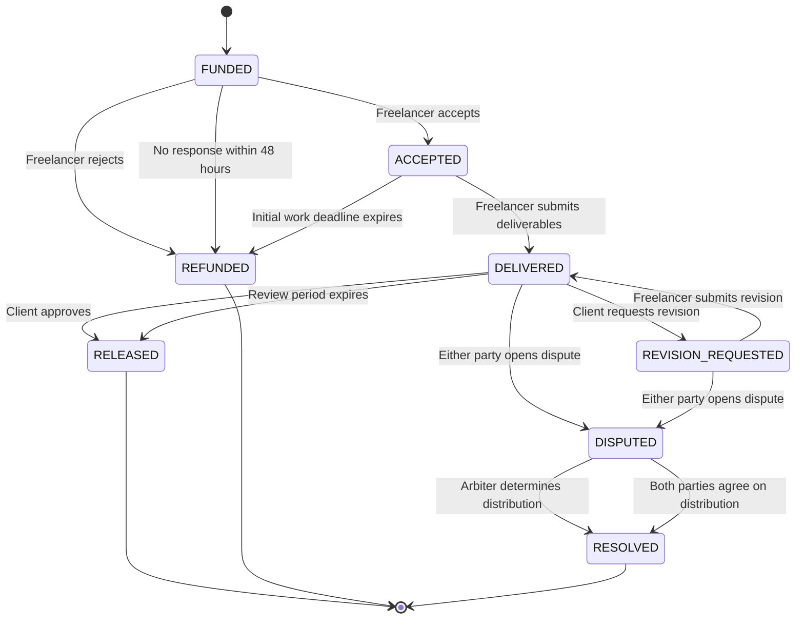

# STATE TRANSITION SPECIFICATION (STS)

**Project:** NEAR Escrow  
**Document Version:** 1.5  
**Status:** Final  
**Revision:** v1.4 aligns §5.12 with D-21: settlement compares the counterparty's proposal only, and differing proposals are a concession opportunity rather than a dead end. v1.3 updates the upstream document reference. v1.2 clarifies that mutual settlement requires an explicit `settle_mutual` call rather than firing when two proposals merely match (§5.12). v1.1 removes the time precondition on `REVISION_REQUESTED → DISPUTED` (§5.10, D-01). The previous wording made a silent freelancer after the revision deadline leave the project with no reachable transition, locking the escrow permanently.  
**Based on:** Functional Specification Document (FSD) v1.5

---

# 1. Introduction

## 1.1 Document Purpose

The State Transition Specification (STS) defines all possible status changes throughout the lifecycle of an escrow project in NEAR Escrow.

This document serves as the primary reference for:

- Designing the state machine within the smart contract.
- Defining valid and invalid status transitions.
- Identifying actors authorized to trigger each transition.
- Establishing the conditions and time constraints for every transition.
- Preventing unauthorized status changes.
- Ensuring that escrow funds cannot be released or refunded more than once.

## 1.2 Scope

This document covers the project lifecycle, beginning when a client creates and funds an escrow project and ending when the funds are released, refunded, or distributed through dispute resolution.

This specification focuses on project statuses and their transition rules. Detailed storage implementation, data structures, callbacks, and smart contract methods will be addressed in the Smart Contract Technical Specification.

---

# 2. Actors and Roles

| Actor | Description |
|---|---|
| Client | The party who creates the project and provides the escrow funds. |
| Freelancer | The party who accepts the project and submits the deliverables. |
| Arbiter | An independent party authorized to determine fund distribution when a dispute occurs. |
| Public Caller | Any NEAR account authorized to trigger specific public functions, such as automatic release after the required time period. |

**Note:** A Public Caller can only execute transitions explicitly permitted for public access. This role does not grant authority to change business decisions or claim escrow funds.

---

# 3. Project Status Definitions

## 3.1 Primary Project Statuses

| Status | Description | Terminal |
|---|---|---|
| `FUNDED` | Funds have been deposited into the smart contract and the project is awaiting the freelancer's decision. | No |
| `ACCEPTED` | The freelancer has accepted the project. | No |
| `DELIVERED` | The freelancer has submitted the deliverables. | No |
| `REVISION_REQUESTED` | The client has requested revisions from the freelancer. | No |
| `DISPUTED` | Either party has opened a dispute. | No |
| `RELEASED` | The entire escrow amount has been allocated to the freelancer. | Yes |
| `REFUNDED` | The entire escrow amount has been allocated to the client. | Yes |
| `RESOLVED` | A dispute has been resolved and the fund distribution has been finalized. | Yes |

A terminal status indicates that the project's business lifecycle has been completed. No further business status transitions are permitted from these states.

## 3.2 Technical Fund Withdrawal State

In addition to the primary project status, the system must distinguish between the final allocation of funds and the actual transfer of funds to the recipient's wallet.

This specification proposes a **pull payment** mechanism.

When a project reaches a terminal status, the smart contract allocates claimable balances to the entitled recipients. Each recipient can then independently call the withdrawal function to transfer their allocated funds to their wallet.

This approach provides the following benefits:

- Project completion does not depend on every recipient withdrawing their funds.
- A failed withdrawal does not invalidate the project's settlement decision.
- Each recipient can independently withdraw their allocated balance.
- A failed transfer must not result in lost funds or duplicate claims.

Detailed withdrawal states and callback handling will be defined in the Smart Contract Technical Specification.

---

# 4. State Machine Overview

## 4.1 Main Project Lifecycle

The diagram illustrates the primary business lifecycle. Additional timing constraints, authorization rules, and validation requirements are specified in the following sections.

---

# 5. Status Transition Definitions

## 5.1 FUNDED → ACCEPTED

**Trigger:** The freelancer accepts the project.

**Authorized Actor:** The freelancer registered when the project was created.

**Preconditions:**
- The project status is `FUNDED`.
- The caller matches the registered freelancer account.
- The acceptance deadline of 48 hours has not expired.
- No other transition has already been executed.

**Effects:**
- The project status changes to `ACCEPTED`.
- The acceptance timestamp is recorded.
- The work deadline remains the deadline specified by the client during project creation.

**Failure Conditions:**
- The caller is not the registered freelancer.
- The project is not in the `FUNDED` state.
- The acceptance deadline has expired.

## 5.2 FUNDED → REFUNDED

This transition can occur for two reasons.

### A. Freelancer Rejects the Project

**Trigger:** The freelancer rejects the project.

**Authorized Actor:** The registered freelancer.

**Preconditions:**
- The project status is `FUNDED`.
- The rejection occurs within the acceptance period.

**Effects:**
- The entire escrow amount is allocated to the client.
- The project status changes to `REFUNDED`.

### B. Freelancer Does Not Respond

**Trigger:** A refund function is called after the acceptance period expires.

**Authorized Actor:** The client.

**Preconditions:**
- The project status is `FUNDED`.
- At least 48 hours have passed since the project was funded.
- The freelancer has neither accepted nor rejected the project.

**Effects:**
- The entire escrow amount is allocated to the client.
- The project status changes to `REFUNDED`.

**Note:** This transition does not require a cron job or backend scheduler. The client must explicitly call the refund function.

## 5.3 ACCEPTED → DELIVERED

**Trigger:** The freelancer submits the project deliverables.

**Authorized Actor:** The registered freelancer.

**Preconditions:**
- The project status is `ACCEPTED`.
- The initial work deadline has not expired.
- A deliverable link and accompanying note have been provided.

**Effects:**
- The project status changes to `DELIVERED`.
- Deliverable information is stored.
- The submission timestamp is recorded.
- A 72-hour review period begins.

**Failure Conditions:**
- The caller is not the registered freelancer.
- The project is not in the `ACCEPTED` state.
- The initial work deadline has expired.
- The submitted deliverable information is invalid.

## 5.4 ACCEPTED → REFUNDED

**Trigger:** The client claims a refund because the freelancer failed to submit the initial deliverable before the work deadline.

**Authorized Actor:** The client.

**Preconditions:**
- The project status is `ACCEPTED`.
- The initial work deadline has expired.
- The freelancer has not submitted any deliverable.

**Effects:**
- The entire escrow amount is allocated to the client.
- The project status changes to `REFUNDED`.

**Note:** This transition only applies to the initial submission deadline. Failure to submit a revised deliverable does not automatically grant a refund through this mechanism.

## 5.5 DELIVERED → RELEASED

**Trigger:** The client approves the submitted work.

**Authorized Actor:** The client.

**Preconditions:**
- The project status is `DELIVERED`.
- The review period has not expired.
- No dispute is currently active.

**Effects:**
- The entire escrow amount is allocated to the freelancer.
- The project status changes to `RELEASED`.
- The freelancer receives a claimable balance.

## 5.6 DELIVERED → REVISION_REQUESTED

**Trigger:** The client requests a revision.

**Authorized Actor:** The client.

**Preconditions:**
- The project status is `DELIVERED`.
- The review period has not expired.
- The number of previously used revisions is less than two.
- No dispute is currently active.

**Effects:**
- The project status changes to `REVISION_REQUESTED`.
- The revision counter increases by one.
- A new revision deadline is established, three days after the revision request.
- The previous review period is no longer applicable.

**Limitation:** A maximum of two revision requests is allowed per project.

## 5.7 DELIVERED → DISPUTED

**Trigger:** Either party opens a dispute.

**Authorized Actors:**
- Client.
- Freelancer.

**Preconditions:**
- The project status is `DELIVERED`.
- The review period has not expired.
- No dispute has previously been opened for the project.

**Effects:**
- The project status changes to `DISPUTED`.
- The automatic release process is blocked.
- Escrow funds remain locked.
- Both parties may submit dispute evidence.

## 5.8 DELIVERED → RELEASED (Automatic Release)

**Trigger:** The review period expires without any action from the client.

**Authorized Actor:** Public Caller.

**Preconditions:**
- The project remains in the `DELIVERED` state.
- The 72-hour review period has expired.
- The client has not approved the work, requested a revision, or opened a dispute.
- No settlement process is currently in progress.

**Effects:**
- The entire escrow amount is allocated to the freelancer.
- The project status changes to `RELEASED`.
- The freelancer receives a claimable balance.

**Note:** Automatic release is not executed automatically by the passage of time. A public account must call the corresponding function after the deadline has expired.

## 5.9 REVISION_REQUESTED → DELIVERED

**Trigger:** The freelancer submits the revised deliverable.

**Authorized Actor:** The registered freelancer.

**Preconditions:**
- The project status is `REVISION_REQUESTED`.
- The revision deadline has not expired.
- Valid revised deliverable information has been provided.

**Effects:**
- The project status changes to `DELIVERED`.
- The previous deliverable information is updated with the latest revision.
- A new 72-hour review period begins.

**Note:** A new review period applies to every submitted revision.

## 5.10 REVISION_REQUESTED → DISPUTED

**Trigger:** Either party opens a dispute concerning the revision or the work requirements.

**Authorized Actors:**
- Client.
- Freelancer.

**Preconditions:**
- The project status is `REVISION_REQUESTED`.
- The project has no dispute previously opened.
- **No time condition applies.** A dispute may be opened while the revision deadline is still running and also after it has passed (see the note below and D-01).

**Rationale for the missing time guard:** if the freelancer never submits the revision, blocking disputes after the revision deadline would leave the project with no reachable transition at all — the freelancer cannot submit, the client cannot claim a refund (FSD §4.5), and the arbiter can only act inside a dispute. That is a permanent fund lock requiring no bad actor, only silence. Allowing the dispute to open at any time in `REVISION_REQUESTED` is the only path that keeps a human decision reachable.

**Effects:**
- The project status changes to `DISPUTED`.
- The revision process is terminated.
- Escrow funds remain locked.
- Both parties may submit dispute evidence.

**Note:** If the freelancer fails to submit a revision before the deadline, the client cannot automatically claim a refund through the initial deadline mechanism. The client may open a dispute.

## 5.11 DISPUTED → RESOLVED (Arbiter Decision)

**Trigger:** The arbiter determines the fund distribution.

**Authorized Actor:** The arbiter registered during project creation.

**Preconditions:**
- The project status is `DISPUTED`.
- The caller matches the registered arbiter account.
- The fund distribution percentage is within the range of 0–100%.
- No previous resolution decision has been finalized.

**Effects:**
- The distribution decision is recorded.
- Each party's claimable balance is calculated according to the decision.
- The project status changes to `RESOLVED`.

**Example:**

If the escrow amount is 10 NEAR and the arbiter assigns 70% to the freelancer:

| Recipient | Percentage | Allocated Amount |
|---|---:|---:|
| Freelancer | 70% | 7 NEAR |
| Client | 30% | 3 NEAR |

**Note:** AI only assists by summarizing evidence and providing recommendations. AI has no authority to modify fund distribution or execute dispute resolution.

## 5.12 DISPUTED → RESOLVED (Mutual Settlement)

**Trigger:** Either party calls `settle_mutual` with the percentage the other party has already proposed. Two matching proposals on their own move nothing — the call is the final approval (FSD §4.9 rule 6).

**Authorized Actors:**
- Client.
- Freelancer.

**Preconditions:**
- The project status is `DISPUTED`.
- The counterparty has a stored proposal equal to the percentage passed to `settle_mutual`.
- The percentage is within the range of 0–100%.
- No resolution decision has already been finalized by the arbiter.

The caller's own stored proposal is **not** compared: the call supersedes it. A party may therefore accept the counterparty's number even after proposing a different one (SCTS D-21, FSD §4.9 rule 4).

**Effects:**
- The agreed fund distribution is recorded.
- Each party's claimable balance is calculated.
- The project status changes to `RESOLVED`.

**Important Rules:**
- A proposal from only one party is insufficient to resolve the dispute.
- Both parties must agree on the same percentage: one via a stored proposal, the other via the `settle_mutual` call itself.
- Differing stored proposals are not a dead end — either party can concede by calling `settle_mutual` with the other's number.
- If the parties fail to reach an agreement, the project remains in `DISPUTED`.
- The system must not automatically distribute funds using a 50:50 split when the arbiter becomes inactive for seven days.

---

# 6. Timing and Deadline Rules

| Activity | Duration | Starting Point |
|---|---:|---|
| Freelancer acceptance period | 48 hours | Project funding |
| Initial deliverable submission | According to project deadline | Project acceptance |
| Work review period | 72 hours | Initial deliverable submission |
| Revised deliverable submission | 3 days | Revision request |
| Revised work review period | 72 hours | Revised deliverable submission |
| Arbiter resolution period | 7 days | Dispute opening |

## 6.1 Time Calculation Rules

All time constraints must use blockchain timestamps rather than the user's device clock.

The following rules apply:

- A deadline is considered expired when the blockchain timestamp reaches or exceeds the specified deadline.
- Transitions requiring an expired deadline can only execute once the deadline has been reached.
- The client or a Public Caller must invoke the relevant function to execute time-based transitions.
- The system does not rely on a backend scheduler.

## 6.2 Arbiter Inactivity

If the arbiter does not provide a decision within seven days:

- The project remains in `DISPUTED`.
- Escrow funds remain locked.
- Both parties may use the mutual settlement mechanism.
- The system does not automatically enforce a 50:50 distribution.

This condition is an MVP limitation and must be clearly communicated to users.

---

# 7. State and Fund Invariants

An invariant is a rule that must always remain true within the smart contract, regardless of the transition path taken.

## 7.1 State Invariants

1. Each project must have exactly one primary status at any given time.
2. A project in a terminal status cannot return to a previous status.
3. A transition can only execute when its current status satisfies the required preconditions.
4. The same transition must not be successfully executed more than once.
5. A project in `DISPUTED` cannot execute automatic release.
6. A project in `RELEASED`, `REFUNDED`, or `RESOLVED` cannot open a new dispute.

## 7.2 Fund Invariants

1. Escrow funds must not be withdrawn before a valid settlement decision exists.
2. The total allocated balances after settlement must equal the original escrow amount.
3. Funds must not be claimed more than once.
4. The client and freelancer cannot modify the fund distribution after a terminal status has been reached.
5. The arbiter cannot modify a finalized resolution decision.
6. Unclaimed funds must remain recorded as liabilities owed by the smart contract to their entitled recipients.

## 7.3 Identity Invariants

1. The client, freelancer, and arbiter must use three distinct NEAR accounts.
2. A freelancer can only accept, reject, or submit deliverables for their own projects.
3. A client can only approve work, request revisions, claim refunds, or open disputes according to their permissions.
4. Only the registered arbiter can finalize an arbiter-based dispute decision.
5. The arbiter cannot be replaced after the freelancer accepts the project.

## 7.4 Revision Invariants

1. A maximum of two revision requests is allowed per project.
2. Each revision request must increment the revision counter by exactly one.
3. Each revision has a three-day submission deadline.
4. Every revised submission starts a new 72-hour review period.
5. Failure to submit a revised deliverable does not automatically trigger a refund.

---

# 8. Exceptional Conditions and System Behavior

| Condition | Expected System Behavior |
|---|---|
| Freelancer attempts to accept a project after 48 hours | Transaction is rejected. |
| Client requests a revision after the review period expires | Transaction is rejected. |
| Client requests more than two revisions | Transaction is rejected. |
| Freelancer submits the initial deliverable after the work deadline | Transaction is rejected. |
| Freelancer submits a revision after the revision deadline | Transaction is rejected. Either party may still open a dispute — the revision deadline does not block it (D-01). |
| Client attempts to trigger automatic release before the review period expires | Transaction is rejected. |
| Public Caller attempts automatic release while the project is `DISPUTED` | Transaction is rejected. |
| Arbiter attempts to resolve a project outside their authority | Transaction is rejected. |
| One party submits a mutual settlement proposal without the other party's approval | Project remains `DISPUTED`. |
| Arbiter becomes inactive for seven days | Project remains `DISPUTED`; funds remain locked. |
| A settlement function is called again after the project reaches a terminal status | Transaction is rejected. |

---

# 9. Fund Withdrawal and Payout

## 9.1 Withdrawal Mechanism

NEAR Escrow proposes a **pull payment** mechanism for fund withdrawal.

When a project reaches a terminal status, the smart contract first allocates the claimable balances to the entitled recipients. Each recipient must then independently initiate a withdrawal to receive their funds.

This mechanism is intended to reduce the risks associated with asynchronous NEAR transfers, particularly when distributing funds to multiple recipients.

## 9.2 Fund Allocation Mapping

| Terminal Status | Recipient | Allocated Balance |
|---|---|---|
| `RELEASED` | Freelancer | 100% |
| `REFUNDED` | Client | 100% |
| `RESOLVED` | Freelancer and Client | According to the arbiter's decision or mutual settlement |

## 9.3 Withdrawal Rules

1. A recipient can only withdraw funds allocated to their account.
2. The withdrawal amount must not exceed the recipient's claimable balance.
3. The balance must be updated or marked as in-progress before initiating an asynchronous transfer.
4. If the transfer succeeds, the corresponding claimable balance is considered paid.
5. If the transfer fails, the claimable balance must be restored so the recipient can retry.
6. A withdrawal request that is still in progress must not be processed again.
7. A failed withdrawal must not invalidate or modify the project's settlement decision.

Detailed callback handling, withdrawal state storage, and failed-transfer recovery mechanisms will be specified in the Smart Contract Technical Specification.

---

# 10. State Machine Acceptance Criteria

The state machine implementation is considered compliant with this specification when:

1. All permitted transitions execute successfully when their preconditions are satisfied.
2. All prohibited transitions are rejected by the smart contract.
3. Only authorized actors can execute their respective transitions.
4. All time-based rules use blockchain timestamps.
5. A freelancer cannot accept a project after the 48-hour acceptance period.
6. A client can claim a refund if the freelancer fails to submit the initial deliverable before the deadline.
7. A client can approve work or request a revision within the review period.
8. The revision count cannot exceed two.
9. Automatic release cannot execute before the review period expires.
10. Automatic release cannot execute while a project is in `DISPUTED`.
11. Both parties can open disputes according to the defined rules.
12. The arbiter can determine a fund distribution between 0% and 100%.
13. Mutual settlement only succeeds when both parties approve the same distribution percentage.
14. No automatic 50:50 distribution occurs when the arbiter becomes inactive.
15. Projects in terminal statuses cannot undergo further business transitions.
16. The total claimable balances must always equal the escrow amount being settled.
17. Withdrawal operations cannot cause double spending or loss of claimable funds.
18. A project in `REVISION_REQUESTED` is always disputable, regardless of whether the revision deadline has passed, so no project can reach a state with zero reachable transitions.

---

# 11. Out of Scope for This Specification

The following details are not defined in this document and will be addressed in subsequent technical documentation:

1. Status storage structures and transition history.
2. Smart contract function names for each transition.
3. Implementation of asynchronous NEAR transfer callbacks.
4. Retry and recovery mechanisms for failed withdrawals.
5. Rounding rules for fund distribution calculations.
6. Storage format for dispute evidence.
7. Smart contract events required by the frontend.
8. Testing strategies for each transition and invariant.

---

# 12. Next Document

After this STS is approved, the next document will be:

**Smart Contract Technical Specification (SCTS)**

This document will translate the business rules and state machine into a technical smart contract design for NEAR, covering:

- Storage structures and data models.
- Public methods and authorization.
- Input validation.
- State transition implementation.
- Escrow fund management.
- Asynchronous transfers and callbacks.
- Withdrawal and recovery mechanisms.
- Events and error handling.
- Contract security and testing.