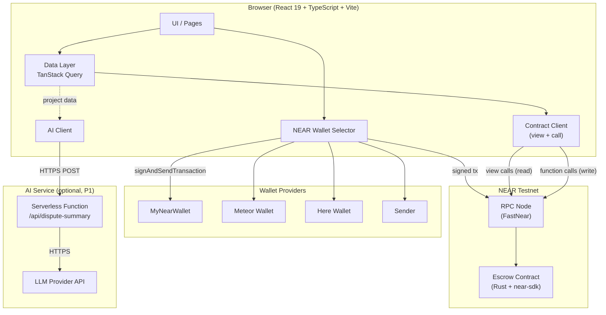
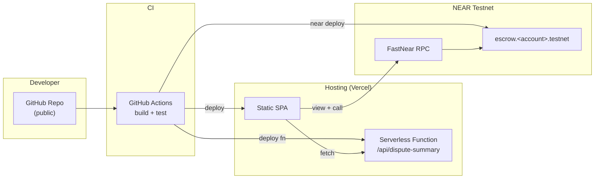
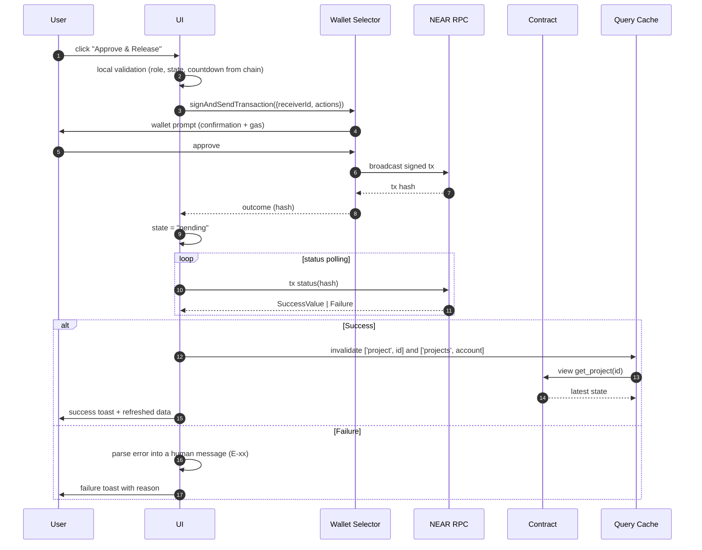
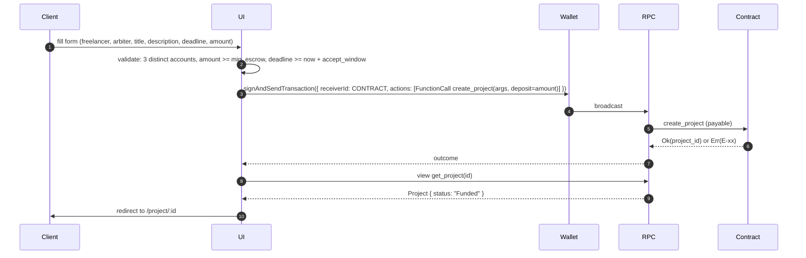
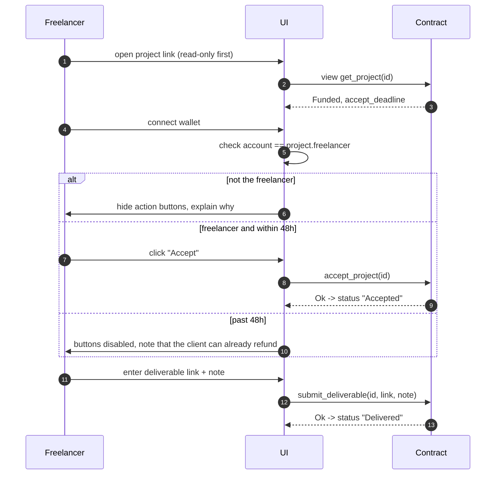
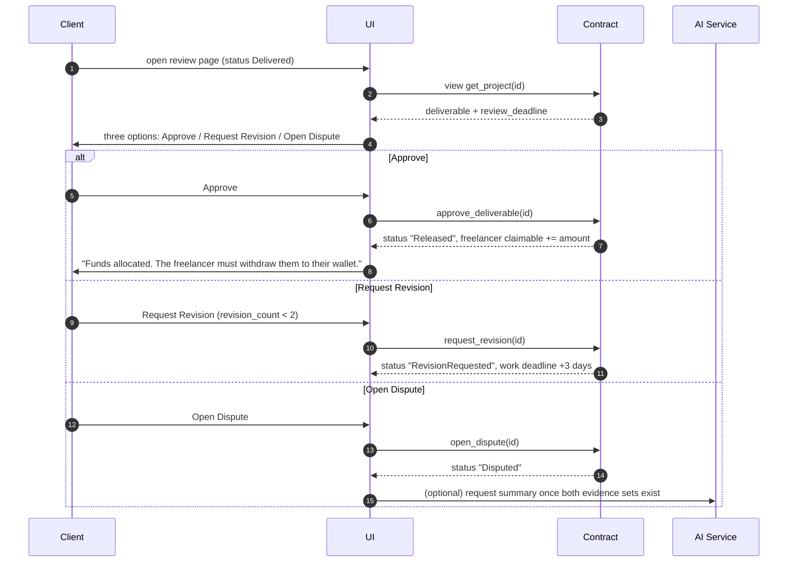
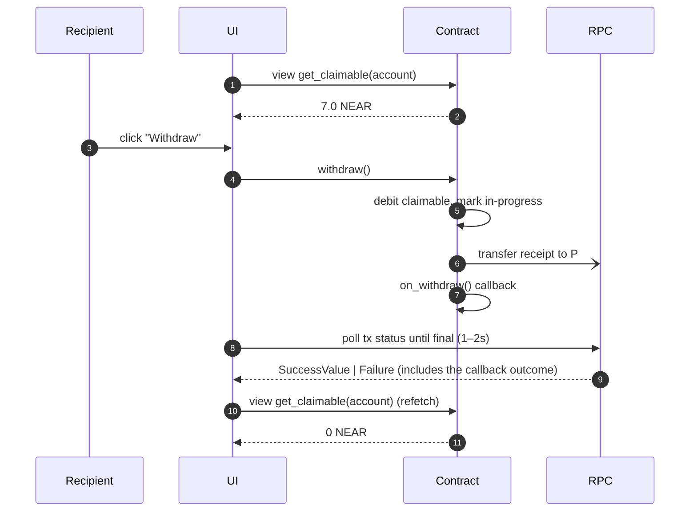

# SYSTEM ARCHITECTURE SPECIFICATION (SAS)

**Project:** NEAR Escrow
**Document Version:** 1.5 — Final
**Status:** Approved
**Date:** November 8, 2026
**Revision:** v1.4 from the fourth audit: the create-project validation line uses `min_escrow` and the 48-hour window instead of a hardcoded 0.1 NEAR and "future", and §12.2 reserve figures reflect the 6,000-byte bound (≈166 projects per 10 NEAR). v1.3 from the third audit: the claimable-balance refresh row no longer mentions event pushes, the AI payload sends `work_deadline` as a string (a JS number would arrive truncated), and the profile page lists every view it actually needs. v1.2 from the second independent audit: the withdrawal flow no longer pretends contract events reach the browser (it polls tx status and refetches), the create-project flow states how `project_id` is read from `SuccessValue`, AI rate limiting and caching are documented as requiring a shared KV store, and `/admin` records that pause is a CLI action. v1.1: `create_project` is a single `FunctionCall` with `deposit` (the earlier two-action snippet would have sent the escrow twice), and the withdraw gas row now states what the app actually sends.
**Based on:** PRD v1.0 · FSD v1.5 · STS v1.5 · SCTS v1.5
**Network:** NEAR Testnet

---

# 1. Purpose and Scope

This document describes how the components of NEAR Escrow communicate: the browser application, the wallet layer, the smart contract, and the optional AI summary service.

In scope:

1. Component overview and responsibilities.
2. Deployment topology.
3. Communication sequences for every business flow.
4. Data reading, caching and freshness strategy.
5. Wallet transaction lifecycle (sign → send → confirm → render).
6. AI service design (P1) and why it can never touch funds.
7. Network, RPC and environment configuration.
8. Repository structure and dependencies.
9. Security, cost, observability and risks.

Out of scope: business rules (FSD), state machine (STS), contract internals (SCTS), granular test cases (document 05), per-function frontend integration guide (document 06).

Every open architectural question raised in the review draft is resolved in **§16 Decisions Record**. Those decisions are normative.

---

# 2. Architecture Principles

| # | Principle | Consequence |
|---|---|---|
| A-P1 | **The blockchain is the only source of truth** | The frontend stores no project state in any database. Every state is re-read from the contract. |
| A-P2 | **No backend, no database** | No application server, no Postgres, no Redis. The only backend is the smart contract plus one optional serverless function for AI. |
| A-P3 | **The wallet holds the keys, the app never does** | The application never sees a seed phrase or private key and never signs anything itself. All signing goes through NEAR Wallet Selector. |
| A-P4 | **Money is never optimistic** | The UI never reports success before the transaction is confirmed on-chain. No optimistic updates on project status or balances. |
| A-P5 | **AI is off the critical path** | If the AI service is down, the entire escrow flow still works. AI only reads; there is no path from AI into the contract. |
| A-P6 | **Failures must be visible** | Every transaction failure maps to an actionable message, never to "Something went wrong". |

---

# 3. Component Overview

## 3.1 Context Diagram



## 3.2 Component Responsibilities

| Component | Responsible for | Not responsible for |
|---|---|---|
| **UI / Pages** | Rendering, navigation, forms, pre-transaction input validation, error presentation | Holding money state, deciding transaction outcomes |
| **Wallet Selector** | Wallet discovery, connect/disconnect, signing, transaction submission | Amount formatting, business validation |
| **Data Layer (TanStack Query)** | View call fetching, caching, refetching, invalidation after transactions | Writing state to the chain |
| **Contract Client** | Typed wrapper for every contract method (view and call), yoctoNEAR conversion, error mapping | Business logic |
| **AI Service** | Accept dispute payloads, call the LLM, return a structured summary, enforce rate limits | Holding funds, mutating status, signing anything |
| **Smart Contract** | All business rules, fund custody, state machine | Presentation, formatting, notifications |

## 3.3 Deliberately Absent Components

| Component | Reason |
|---|---|
| Backend API server | All data lives on-chain; a server would only add a failure point and cost. |
| Database | No state needs off-chain persistence. Caching is entirely in browser memory. |
| Cron / scheduler | All time-based transitions are invoked manually (SCTS P-4). |
| Indexer / subgraph | Contract views with per-account indexes are sufficient at demo scale. |
| Auth server | Identity is a NEAR account. No email, no password, no session. |
| File storage | Deliverables and evidence are **links**, not files. The contract stores strings only. |

---

# 4. Deployment Topology



| Artifact | Location | Notes |
|---|---|---|
| Frontend (static SPA) | Vercel | No SSR. `VITE_*` variables injected at build time. |
| Smart contract (`.wasm`) | NEAR Testnet | Deployed via CLI, never from the browser. |
| AI function | Vercel Serverless Function | The LLM API key exists only here. |
| Documentation | `docs/` in the repo | PRD, FSD, STS, SCTS, SAS, Test Plan, Integration Spec. |

**Why a static SPA and not SSR:** the application is fully client-side — the wallet lives in the browser and all data comes from RPC. SSR adds no benefit and complicates wallet integration.

---

# 5. Communication Flows

## 5.1 Transaction Lifecycle (the pattern behind every write action)



Binding rules:

1. **No UI state change before confirmation.** The trigger button enters a `pending` state, is disabled, and shows a spinner.
2. **After success, always refetch** from the contract. Never construct the new state from a local assumption such as "status is now Released".
3. **Polling timeout** (60 seconds proposed) → show "Transaction still processing, check the explorer" with a link to `testnet.nearblocks.io/txns/<hash>`.
4. **User rejects in the wallet** → treat as an ordinary cancellation, not a red error.

## 5.2 Flow: Create Project and Deposit Funds



Technical notes:

- **How the UI obtains `project_id`:** `create_project` returns `Ok(id)` as a JSON-serialised `u64` inside the transaction's `SuccessValue`. There is no event push, so the app reads `result.transaction_outcome...` → `status.SuccessValue`, base64-decodes it, and parses the integer. If the `SuccessValue` is empty or unparsable, fall back to `get_projects(me, "client", 0, 1)` and take the newest id, rather than leaving the user on a blank page. (Alternative: make `create_project` return a `ProjectView` — one extra read avoided, but a larger return payload.)
- The escrow value is attached as the **`deposit` of a single `FunctionCall` action**, never as an additional `Transfer` action. A `FunctionCall` with a non-zero deposit already transfers that NEAR; adding a `Transfer` action on top would send the escrow twice. See Integration Specification D-11.
- Amounts are converted to yoctoNEAR with `BigInt`, never with `Number` or floating point.
- Large integers are passed as strings (`U128`), so JavaScript precision can never truncate a balance.

## 5.3 Flow: Freelancer Accepts and Submits Work



## 5.4 Flow: Client Review — Approve, Revision, or Dispute



## 5.5 Flow: Dispute with AI Summary (P1)

```mermaid
sequenceDiagram
    autonumber
    participant P as Client / Freelancer
    participant UI
    participant K as Contract
    participant FN as AI Function
    participant L as LLM

    P->>UI: submit evidence (link + note)
    UI->>K: submit_evidence(id, link, note)
    K-->>UI: Ok

    P->>UI: click "Generate AI Summary"
    UI->>K: view get_project(id)
    K-->>UI: description, deliverable, both evidence sets
    UI->>FN: POST /api/dispute-summary { project, evidence }
    FN->>FN: validate payload, rate limit, clamp lengths
    FN->>L: structured prompt
    L-->>FN: JSON summary
    FN->>FN: schema validation + sanitisation
    FN-->>UI: { summary, points, suggested_split, disclaimer }
    UI->>P: render; the arbiter uses it as input, never as a decision
```

**Hard boundary:** the AI response is never sent to the contract. No contract method accepts an AI argument. The arbiter sets the percentage manually through `arbiter_resolve`.

If the AI service is unavailable, the UI shows "AI summary unavailable" and the dispute flow continues normally. This is not a critical failure.

## 5.6 Flow: Fund Withdrawal (pull payment)



**No event is pushed to the browser.** The dApp has no indexer and no WebSocket (D-04); contract events are written to the receipt log and are only visible by reading the transaction or by a future indexer. The UI learns the outcome by polling the transaction status (which includes the callback receipt) and then refetching the view. The `withdraw_succeeded` / `withdraw_failed` events exist for explorers and off-chain monitoring, not as a client transport.

Critical UX note: after **Approve** or **Arbiter Resolve**, funds are **not** in the recipient's wallet yet. They sit in `claimable`. The UI must present this as two explicit steps:

> "Funds have been allocated. Click Withdraw to move them to your wallet."

Without this explanation, judges and users will believe the money has disappeared.

---

# 6. Data Layer and Freshness

## 6.1 Data Sources

| Data | Source | Frequency |
|---|---|---|
| Project detail | `get_project(id)` | on mount + after tx + poll every 15s |
| Account project list | `get_projects(account, role, from, limit)` | on mount + after tx |
| Claimable balance | `get_claimable(account)` | on mount + after tx + after the withdraw transaction reaches finality (polled, not pushed) |
| Reputation stats | `get_stats(account)` | on mount |
| Config and time windows | `get_config()` | once per session (5-minute cache) |
| Wallet balance | RPC `view_account` | poll every 30s |
| Transaction status | RPC `tx status` | poll every 1–2s until final |

## 6.2 Cache Rules

- Query keys: `['project', id]`, `['projects', account, role]`, `['claimable', account]`, `['stats', account]`.
- `staleTime` 10 seconds; `refetchOnWindowFocus: true`.
- After a successful transaction: `invalidateQueries` for every affected key.
- **Never** store project state in `localStorage` as truth. Only UI preferences (theme, last wallet) may be persisted.

## 6.3 When Data Disagrees

If a view call returns a status the UI did not expect — for example another participant already triggered `release_after_review` — the UI follows the chain, never its own assumption. Action buttons are recomputed from the latest status; if an action is no longer valid, the button disappears and an explanation replaces it.

---

# 7. Wallet and Identity

## 7.1 Wallet Selector Configuration

```ts
const selector = await setupWalletSelector({
  network: {
    networkId: 'testnet',
    nodeUrl: import.meta.env.VITE_RPC_URL,
    walletUrl: 'https://testnet.mynearwallet.com',
    helperUrl: 'https://helper.testnet.near.org',
    explorerUrl: 'https://testnet.nearblocks.io',
  },
  modules: [
    new MyNearWallet({ walletUrl: 'https://testnet.mynearwallet.com' }),
    new MeteorWallet({}),
    new HereWallet({}),
    new Sender({}),
  ],
});
```

| Aspect | Rule |
|---|---|
| Network | Testnet only for the MVP. Mainnet is explicitly refused by a runtime guard, because escrow funds would be real. |
| Account switch | If `accountId` changes (user switches account in the wallet), **invalidate every query** and refetch. |
| Disconnect | Clear query cache and local state, but never force a redirect. |
| Read-only | Project detail pages are viewable without a wallet. Action buttons prompt a connect. |
| Session | No server session. The wallet selector persists the chosen wallet in `localStorage`. |

## 7.2 Wallet Security Rules

1. The application **never** asks for a seed phrase or private key. There is no UI for it.
2. No key material is ever written to `localStorage`.
3. The wallet prompt must show `receiverId = CONTRACT_ID`; the app verifies `CONTRACT_ID` against its environment before sending anything.
4. Every `FunctionCall` sets explicit `gas` and explicit `deposit` (0 for non-payable methods, the escrow amount for `create_project`). Contract defaults are never relied on.

---

# 8. AI Service (P1)

## 8.1 Why Serverless and Not Directly from the Browser

| Approach | Problem |
|---|---|
| Call the LLM API from the browser | The API key is exposed in the public JS bundle. Unacceptable. |
| Full backend server | Overkill; a single stateless endpoint does not need a server. |
| **Serverless function** ✅ | Key stays server-side, zero cost while idle, one-command deploy. |

## 8.2 API Contract

```
POST /api/dispute-summary
Content-Type: application/json

{
  "project": {
    "id": 12,
    "title": "...",
    "description": "...",
    "amount_near": "10.0",
    "work_deadline": "1730000000000000000",
    "revisions": 1
  },
  "deliverable": { "link": "...", "note": "..." },
  "evidence": {
    "client":     { "link": "...", "note": "..." },
    "freelancer": { "link": "...", "note": "..." }
  }
}
```

Response (strict schema, validated in the function **and** in the client):

```json
{
  "summary": "string, max 1200 chars",
  "client_position": "string, max 400 chars",
  "freelancer_position": "string, max 400 chars",
  "matches": ["points consistent with the project description"],
  "mismatches": ["points inconsistent with the project description"],
  "suggested_split": { "freelancer_percent": 70, "client_percent": 30 },
  "confidence": "low | medium | high",
  "disclaimer": "Advisory only. The arbiter makes the final decision."
}
```

## 8.3 Limits and Guardrails

| Guardrail | Value |
|---|---|
| Total payload length | max 8,000 characters (truncated before reaching the LLM) |
| Rate limit | 5 requests / minute / IP — **requires a shared store** (Vercel KV / Upstash / Cloudflare KV). A module-level variable only counts per warm instance, so the limit is advisory at best. Until a store is provisioned, describe this as best-effort, not a guarantee. |
| Cache | payload hash → response cached for 1 hour — same constraint: in-memory caching is per instance and cold starts drop it. Without KV, treat the cache as an optimisation, never as a correctness or cost guarantee. |
| Timeout | 20 seconds; UI shows a fallback past that |
| PII | The function rejects payloads containing email or phone patterns |
| Determinism | Low `temperature`; output must be valid JSON (validated, one retry) |
| Disclaimer | Always included; the client cannot strip it |

## 8.4 What the AI Must Never Do

1. Sign transactions.
2. Call contract methods.
3. Persist dispute data beyond a short-lived cache.
4. Act as a precondition for `arbiter_resolve` — the arbiter can decide without ever opening an AI summary.

---

# 9. Configuration and Environment

```bash
# app/.env
VITE_NETWORK_ID=testnet
VITE_CONTRACT_ID=escrow.farel.testnet
VITE_RPC_URL=https://testnet.fastnear.com
VITE_AI_ENDPOINT=/api/dispute-summary
VITE_EXPLORER_URL=https://testnet.nearblocks.io

# ai-service/.env  (NEVER prefix with VITE_)
LLM_API_KEY=***
LLM_MODEL=***
RATE_LIMIT_PER_MIN=5
```

Rules:

- Every variable prefixed `VITE_` is **public** (it ships in the bundle). No secrets allowed.
- `CONTRACT_ID` is validated at startup; if missing, the app shows a configuration screen instead of crashing.
- No `.env` file is committed. Only `.env.example`.

---

# 10. Repository Structure

```
near-escrow/
├── contract/                 # Rust, near-sdk
│   ├── src/
│   ├── tests/
│   └── Cargo.toml
├── app/                      # React 19 + TS + Vite
│   ├── src/
│   │   ├── main.tsx
│   │   ├── App.tsx
│   │   ├── config/           # env, constants, contract id
│   │   ├── lib/
│   │   │   ├── near/         # selector init, contract client, view client
│   │   │   ├── format.ts     # yoctoNEAR <-> NEAR, dates, durations
│   │   │   └── errors.ts     # E-xx -> human messages
│   │   ├── hooks/            # useProject, useMyProjects, useClaimable, useTxStatus
│   │   ├── components/       # ui primitives, StatusBadge, Countdown, TxButton
│   │   ├── pages/            # Landing, CreateProject, Dashboard, ProjectDetail, Profile
│   │   └── types/            # contract view result types
│   └── vite.config.ts
├── ai-service/               # serverless function (P1)
│   ├── api/dispute-summary.ts
│   └── package.json
├── docs/                     # PRD, FSD, STS, SCTS, SAS, Test Plan, Integration
└── README.md
```

## 10.1 Core Dependencies

| Package | Purpose |
|---|---|
| `react` 19, `react-dom` | UI |
| `typescript`, `vite` | Build and type checking |
| `@near-wallet-selector/core` + wallet modules | Connect and sign |
| `near-api-js` | RPC client, view calls, transaction status |
| `@tanstack/react-query` | Data fetching and caching |
| `react-router-dom` | SPA routing |
| `tailwindcss` | Styling |
| `zod` | Form input and AI response validation |
| `date-fns` | Deadline formatting |

## 10.2 Page ↔ Contract Action Map

| Page | Views | Write actions |
|---|---|---|
| `/` Landing | `get_project_count`, sample `get_stats` | — |
| `/create` | `get_config` | `create_project` |
| `/dashboard` | `get_projects(account, role)` | — |
| `/project/:id` | `get_project` | `accept_project`, `reject_project`, `submit_deliverable`, `approve_deliverable`, `request_revision`, `open_dispute`, `submit_evidence`, `arbiter_resolve`, `propose_settlement`, `settle_mutual`, `release_after_review`, `claim_no_response_refund`, `claim_deadline_refund` |
| `/profile/:account` | `get_stats`, `get_claimable`, `get_claimable_per_project`, `get_withdrawal_state`, wallet balance | `withdraw` |
| `/dispute/:id` | `get_project` | `submit_evidence`, `arbiter_resolve`, `propose_settlement`, `settle_mutual` |
| `/admin` (owner only) | `get_fund_invariants`, `get_config`, `get_state_version` | — (read-only; `set_paused` is an operator CLI action) |

Which buttons render is computed from **(status × caller role × time)**, not from the route. Document 06 contains the full action eligibility matrix.

---

# 11. System Security

| # | Risk | Mitigation |
|---|---|---|
| S-1 | LLM API key leaked | Lives only in the serverless function; never `VITE_`; rotate if in doubt. |
| S-2 | Transaction sent to a lookalike contract | `CONTRACT_ID` comes from env and is verified at runtime; the contract address is shown in the footer. |
| S-3 | Phishing / wallet drain | The app never requests anything but a `FunctionCall` to a single contract. It never adds a `fullAccess` key. |
| S-4 | User on the wrong network | Network ID is hardcoded to testnet; a mainnet wallet is refused with a clear message. |
| S-5 | XSS through on-chain data | All strings from the contract render as text, never via `dangerouslySetInnerHTML`. External links are validated as `https://` and carry `rel="noopener noreferrer"`. |
| S-6 | Project spam (storage cost) | `MIN_ESCROW` plus the storage reserve (SCTS D-01); `paused` as an emergency brake. |
| S-7 | Evidence containing PII | Prominent warning in the form stating that on-chain data is public and permanent. |
| S-8 | Prompt injection via evidence | The system prompt separates user data; output is schema-validated JSON; and AI has no authority at all, so injection has no financial effect. |

---

# 12. Cost and Performance

## 12.1 Gas Estimates (testnet)

| Action | Gas | Notes |
|---|---|---|
| `create_project` | 20–30 Tgas | Includes index writes; largest storage delta |
| `accept_project` | 10 Tgas | |
| `submit_deliverable` | 15 Tgas | Writes strings |
| `approve_deliverable` | 20 Tgas | Includes settlement and credit |
| `open_dispute` | 10 Tgas | |
| `arbiter_resolve` | 20 Tgas | |
| `withdraw` | ≥ 30 Tgas (contract minimum) | The app sends **50 Tgas** — the surplus is headroom for the callback (Integration Spec §3.3) |

## 12.2 Storage Cost (paid from the reserve, never from escrow)

Approximately **0.06 NEAR per project**, derived from the worst-case bound in SCTS D-23 (6,000 bytes × `1e19` yocto/byte). A 10 NEAR reserve therefore covers ≈166 projects, and the recommended demo funding is **20 NEAR (≈333 projects)** — see SCTS §5.2.1. `get_fund_invariants()` is displayed on the read-only `/admin` page for monitoring.

## 12.3 Performance Targets

| Metric | Target |
|---|---|
| First contentful paint | < 1.5s |
| Initial JS bundle | < 400 KB gzipped |
| View call (dedicated RPC) | < 800ms |
| Transaction confirmation | < 5s on testnet |
| Contract wasm size | < 300 KB |

---

# 13. Observability

| Need | Method |
|---|---|
| Transaction history | Link to `testnet.nearblocks.io/txns/<hash>` on every toast |
| Current state | Always readable via view calls, no special tooling |
| Contract events | `near_escrow` NEP-297; inspectable in the explorer and used for manual debugging |
| Reserve health | `get_fund_invariants()` on the `/admin` page |
| AI logs | Platform-provided function logs, no PII |
| Error tracking | Optional Sentry in the frontend, with no wallet data attached |

No custom metrics dashboard. For the hackathon, the NEAR explorer is the dashboard.

---

# 14. Risks and Mitigations

| Risk | Impact | Mitigation |
|---|---|---|
| RPC rate limiting during the demo | Transactions fail to display on stage | Dedicated RPC (D-02) plus retry with backoff and a manual "Retry" button |
| No wallet extension installed | User or judge cannot connect | Provide a demo account and a one-line guide; MyNearWallet works in-browser with no extension |
| Serverless cold start | AI summary feels slow | 20s timeout, skeleton loader, and copy stating it can be skipped |
| Two-minute demo is tight | Flow feels too long | The project detail page renders only the currently valid actions; no nested menus |
| Client clock differs from chain time | Countdown says "expired" when it is not | Button eligibility always uses chain timestamps from `get_project`/`get_config`; local time is used only for the visual countdown |
| AI provider outage | Summary unavailable | Feature is optional and clearly labelled; dispute flow unaffected |

---

# 15. Data Flow Summary

```
User action
   ↓
UI (local validation; role, status and time read from chain data)
   ↓
Wallet Selector (signing)
   ↓
NEAR RPC → Smart Contract (all rules, all money)
   ↓
Tx outcome → UI (pending → success / failure)
   ↓
invalidate cache → refetch view → render new state
```

One sentence summarises this document: **the UI is allowed to guess wrong; the contract is not.** Every decision that involves money is made and enforced on-chain; the UI only reflects it and guides the user.

---

# 16. Decisions Record

All items below were open in the review draft and are now **final**.

### D-01 — Frontend hosting on Vercel

Static SPA deployed from GitHub, with the AI serverless function in the same project.

*Rationale:* automatic deploys, preview URLs per pull request, and one dashboard for both the static app and the AI endpoint. Netlify would work equally well; Vercel is chosen to keep the AI function co-located with the app.

### D-02 — Dedicated RPC (FastNear), not the public endpoint

`VITE_RPC_URL = https://testnet.fastnear.com`.

*Rationale:* the public `rpc.testnet.near.org` rate-limits aggressively. A failed view call in front of judges is the single easiest way to lose a demo. A dedicated testnet endpoint is free and removes that risk class entirely.

### D-03 — Wallet modules: MyNearWallet, Meteor, Here, Sender

Four modules, which is the de-facto standard set.

*Rationale:* judges and testers are likely to already have one of them. MyNearWallet is web-based, so a user with no extension can still complete the flow — this is the fallback that matters most in a demo.

*Excluded:* Ledger (irrelevant for a testnet demo), Nightly (duplicates Meteor's audience).

### D-04 — Data layer: TanStack Query polling plus post-transaction refetch

15-second polling on project views, immediate invalidation after any transaction.

*Rationale:* view calls are fast and the state space is tiny. A WebSocket event listener would add connection management and reconnect logic for almost no user-visible benefit at demo scale. The event stream remains available for anyone who wants to build it later.

### D-05 — AI runs behind a serverless function, never from the browser

*Rationale:* non-negotiable — an API key in a public bundle is a leaked key. The function also provides the natural place for rate limiting, payload clamping and schema validation.

### D-06 — No custom indexer

*Rationale:* contract views with per-account indexes cover every screen. Each additional moving part is a component that can fail during the demo.

*Known limit:* `get_projects` and `get_stats` are linear in project count per account (see SCTS §4.4). Acceptable at MVP scale; revisit only if an account accumulates hundreds of projects.

### D-07 — English UI

Per FSD §9, the interface is English with short helper text, for an international judging panel. Code identifiers, comments, commit messages and documentation are English as well.

### D-08 — Dark theme only

A single minimal dark theme, no theme switcher.

*Rationale:* halves the design and QA surface, and matches the preferred aesthetic. Light mode is not planned.

### D-09 — Read-only `/admin` page for reserve monitoring

Owner-only view rendering `get_fund_invariants()` and `get_config()`.

*Rationale:* the storage reserve (SCTS D-01) is a real operational risk — if it drains, `create_project` starts failing with `E-14`. A single read-only page makes that visible before it happens. No write actions live here, and no admin power over user funds is introduced.

---

# 17. Document Status

This specification is **approved and final (v1.5)**. It supersedes all earlier versions and is the authoritative architecture reference for NEAR Escrow.

Next document: **05 — Test Plan and Test Cases**.
